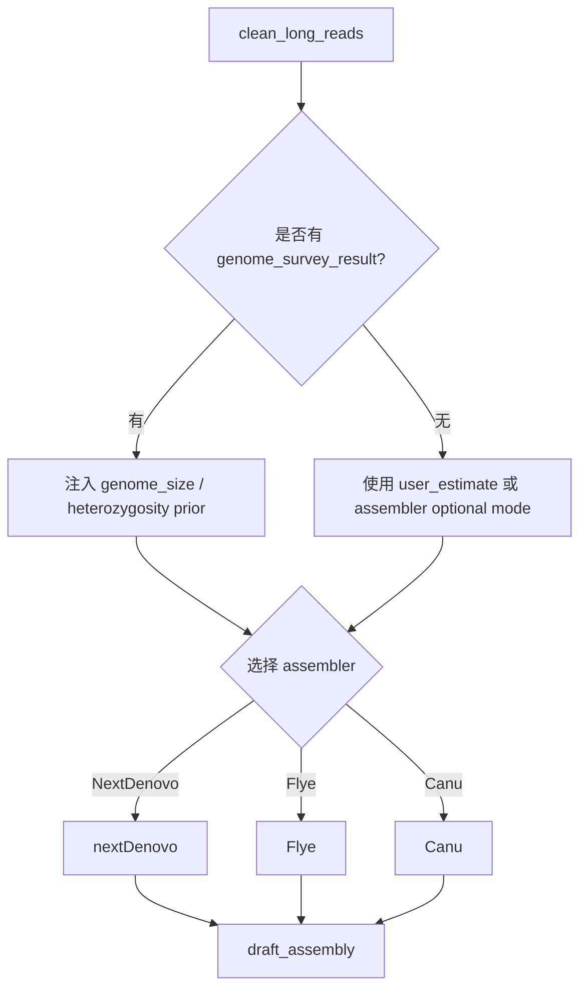
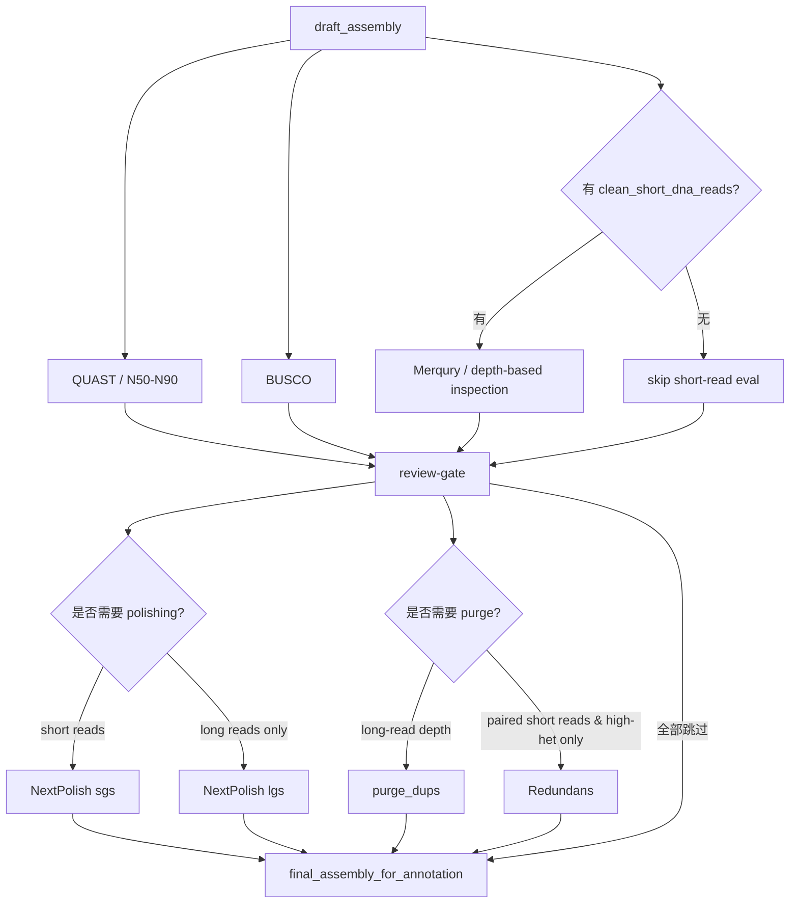

# ONT/CLR 长读长场景的 Agent / Planner 工作流规范

## 执行摘要

这份文档以你已经设计好的 LangGraph 风格架构为前提：`Project Entry → Input Inventory → Asset Normalization → Read QC & Preparation → Genome Survey（如适用）→ Assembly → Assembly Evaluation / Polish / Purge → Hi-C Scaffolding（可选）→ Repeat Annotation → Gene Structure Annotation → Function Annotation`。在 ONT/CLR 场景里，真正驱动组装的核心资产是 `clean_long_reads`；`clean_short_dna_reads` 只在**有二代 DNA 数据**时参与 genome survey、GC-depth / k-mer 评估和短读长 polishing；`hic_reads_registered` 只在有 Hi-C 数据且目标是染色体级组装时进入子图；RNA-seq / Iso-seq 则主要服务于结构注释，而不是组装本身。LangGraph 的 `StateGraph`、subgraph、checkpointer、interrupt / human-in-the-loop、durable execution 很适合把这些生信“阶段性资产”和“人工 review gate”建模成长期可恢复的工作流。citeturn28view0turn28view1turn28view2turn28view3turn28view4turn28view5turn28view6

在 ONT/CLR 场景下，GenomeScope/Jellyfish 型 survey **默认不应对原始长读长直接启用**，因为 GenomeScope 明确依赖低错误率 reads；GenomeScope 2.0 论文也明确指出其当前支持的是低错误率短读长，尚未扩展到高错误率单分子长读长。因此，Planner 的默认规则应是：**只有存在 clean_short_dna_reads 时才执行 genome survey**；若没有准确短读长，则跳过 Subgraph 2，并由用户提供 `genome_size`（文献、流式细胞术、既有估计）或仅选择能不强依赖该参数的 assembler 路径。citeturn22search0turn22search12turn35search1turn35search5

组装主路径建议按数据与项目复杂度分层：`NextDenovo` 适合 CLR/ONT 的大基因组“先纠错再组装”路径；`Flye` 适合 raw long reads 直接组装，且官方文档强调对 raw reads 不要求预先纠错或修剪；`Canu` 仍是保守但资源重的备选。评估与修正阶段不宜写成固定直线，而应是“先评估 → review-gate → 条件触发 polish / purge / redundans”。其中 `NextPolish` 明确支持 short reads only、long reads only 或两者联合；`purge_dups` 基于 long-read depth + self-alignment；`Redundans` 则更偏向“有 paired short reads 的高杂合组装去冗余 / 脚手架 / gap closing”，因此在纯长读长场景应设为条件可选而不是默认。citeturn36search1turn36search0turn23search0turn33search0turn33search2turn4search1turn4search3turn4search5turn7view0turn24search0turn24search2

对 Agent/Planner 来说，`register` 不是某个生信软件，而是你系统里的**标准化资产登记动作**：把外部文件统一登记为 `asset_type / sample / platform / format / checksum / stage_allowed / metadata / provenance`，然后由 Planner 决定该资产可进入哪些 subgraph、允许哪些方法、哪些步骤跳过。用 LangGraph 的 state channel + reducer 维护“资产总账”和“阶段报告列表”，再用 checkpointer 保存每一步检查点、用 interrupt 作为人工审批门，是这个系统能工程落地的关键。citeturn28view1turn28view2turn28view3turn28view5

## 优先覆盖的 LangGraph 设计依据

按你的要求，优先覆盖并先检索的站点是 `langchain.com / docs.langchain.com`。本报告直接使用了 LangGraph 官方文档中的这些页面作为架构依据：`Overview`、`Graph API`、`Subgraphs`、`Persistence`、`Durable execution`、`Interrupts`、`Thinking in LangGraph`。这些文档共同说明了：LangGraph 适合低层级、长时、可恢复的 stateful workflow；每个 node 只返回 state update；每个 state key 可以配置 reducer；subgraph 可以作为父图中的 node；checkpointer 会在每一步持久化 state；interrupt 可以在任意节点挂起等待外部输入；durable execution 要求 side effects 尽量包在 task / node 中并保证可重放时幂等。citeturn28view0turn28view1turn28view2turn28view3turn28view4turn28view5turn28view6

对你的项目，推荐把 Planner state 设计成三层。第一层是 `assets`，记录标准资产对象；第二层是 `plan`，记录每个 subgraph 的 `allowed_methods / selected_method / skip_reason / depends_on / review_required`；第三层是 `runtime`，记录线程号、当前节点、错误、重试次数、日志位置、已产生的报告。LangGraph 的 reducer 适合把 `reports[]`、`artifacts[]`、`warnings[]` 这类集合型状态累加起来，而对 `selected_method`、`qc_passed` 这类单值状态则用默认覆盖型 reducer 即可。citeturn28view1turn28view3

“review-gate” 很适合直接做成 `interrupt()` 节点，而不是普通 if/else。原因是：组装评估、人审 cutoffs、决定是否 purge / polish / Hi-C，是典型的人在回路场景；LangGraph 在 interrupt 时会持久化 state，并通过同一个 `thread_id` 恢复执行。对于像提交集群任务、写结果文件、移动大文件、写数据库等 side effects，官方 durable execution 指南建议包到 task / node 中并设计为幂等，否则恢复执行时容易重复提交或重复写出。citeturn28view4turn28view5turn28view6

## ONT/CLR 场景的标准资产与全局 planner state

### 标准资产与阶段绑定表

下表是面向 **ONT/CLR long reads 场景** 的最小闭环资产表。`register` 表示“登记进全局 state 并完成元数据标准化”，不是外部分析软件。

| 标准资产 | 可进入阶段 | 绑定方法 |
|---|---|---|
| `raw_long_reads` | Asset Normalization / Read QC & Preparation | register, NanoPlot, SeqKit stats, Filtlong（可选） |
| `clean_long_reads` | Assembly / Evaluation / Polish / Purge | NextDenovo, Flye, Canu, minimap2, NextPolish(lgs), purge_dups |
| `raw_short_dna_reads` | Read QC & Preparation / Genome Survey / Evaluation / Polish | SOAPnuke, FastQC, Jellyfish, GenomeScope, bwa/minimap2, NextPolish(sgs), Merqury |
| `clean_short_dna_reads` | Genome Survey / Evaluation / Polish | Jellyfish, GenomeScope, Merqury, NextPolish(sgs), GC-depth mapping |
| `raw_rnaseq_reads` | Read QC & Preparation / Gene Structure Annotation | SOAPnuke, FastQC, HISAT2, StringTie |
| `clean_rnaseq_reads` | Gene Structure Annotation | HISAT2, StringTie, AUGUSTUS hints, GeMoMa（RNA 支持） |
| `raw_isoseq_or_long_rna_reads` | Read QC & Preparation / Gene Structure Annotation | register, IsoQuant, minimap2 splice |
| `transcript_ccs_reads` / `clean_isoseq_reads` | Gene Structure Annotation | IsoQuant, StringTie（如转 BAM/GTF）、evidence merge |
| `draft_assembly` | Evaluation / Polish / Purge / Hi-C / Repeat / Gene Annotation | QUAST, BUSCO, NextPolish, purge_dups, Hi-C scaffolding, RepeatModeler/RepeatMasker |
| `genome_survey_result` | Assembly | genome size prior, heterozygosity prior, repeat prior |
| `hic_reads_registered` | Hi-C Scaffolding | register, HiC-Pro, Juicer, 3D-DNA, Juicebox |
| `repeat_annotation` | Gene Structure Annotation / Function Annotation | masked genome, TE GFF, repeat library |
| `gene_models` / `predicted_proteins` | Function Annotation | InterProScan, DIAMOND, KofamScan, UniProt/Swiss-Prot mapping |

上表中的方法绑定，来自各工具官方定位：NanoPlot / Filtlong / SeqKit 分别负责长读长统计、质量过滤和 FASTA/Q 统计；SOAPnuke / FastQC 面向 FASTQ 预处理与可视化 QC；GenomeScope 依赖 Jellyfish/KMC 生成的 k-mer 频谱且要求低错误率 short reads；NextDenovo / Flye / Canu 面向长读长 de novo assembly；NextPolish 支持 short / long / hybrid polishing；purge_dups 用覆盖深度与自比对去除 haplotigs 和 overlaps；HiC-Pro / Juicer / 3D-DNA / Juicebox 负责 Hi-C 处理与染色体级脚手架；RepeatModeler / RepeatMasker / TRF 负责重复注释；AUGUSTUS / GeMoMa / Miniprot / StringTie / IsoQuant / EVM 面向结构注释；InterProScan / DIAMOND / KofamScan / UniProt 面向功能注释。citeturn21search0turn21search1turn21search8turn34search0turn34search1turn22search0turn36search1turn23search0turn20search0turn4search1turn7view0turn9search0turn9search1turn10search0turn11search0turn12search0turn11search1turn17search2turn17search4turn14search0turn31view0turn14search1turn17search18turn19search0turn29view0turn19search2turn19search24

### 关键依赖规则

在这个场景里，**依赖 `genome_survey_result` 的步骤只有 Assembly 的参数初始化，不是组装算法本身**。Flye 在 2.8 之后将 `--genome-size` 变成可选，但如果你要用 `--asm-coverage` 节省内存，仍然需要 genome size；NextDenovo 和 Canu 则都把 genome size 当成关键输入。换言之，Planner 应把 `genome_survey_result` 当作“优先的 genome_size 来源”，而不是“Assembly 的强制前置结果”。citeturn33search0turn33search2turn36search0turn36search1turn3search3turn3search4

**依赖 short reads 的关键步骤**主要有三类：Genome Survey、Merqury / depth-based reference-free evaluation、short-read polishing。Merqury 官方明确说它利用 Illumina whole-genome reads 的 k-mer 频谱对组装进行 reference-free 质量评估；GenomeScope 则明确要求低错误率测序；NextPolish 也明确支持 `sgs_fofn` 的 short-read polishing 模块。因此，如果 `clean_short_dna_reads` 缺失，Planner 应自动关闭这几条路径，并仅保留 long-read assembly / long-read polishing / long-read depth purge 的方案。citeturn20search1turn22search0turn22search12turn4search1turn4search5

**依赖 polishing reads 的步骤**主要是 Subgraph 4。`NextPolish` 可以只用 long reads，也可以只用 short reads，或者两者结合；但如果你追求单碱基精度，准确 short reads 仍然是优先选择。纯 ONT/CLR only 项目在没有 short reads 时，也能走 `NextPolish(lgs)`，只是 Planner 需要把其输出标记成“long-read-polished”，而不是“short-read-polished”。citeturn4search1turn4search3turn4search7

### `register` 的定义

在这个系统里，`register` 是**内部行为**，不是官方生信术语。它的作用是把外部文件登记为标准资产对象，并推断或校验以下信息：`asset_type`、`sample_id`、`platform`、`layout`、`format`、`compression`、`checksum`、`size_bytes`、`estimated_pairs`、`allowed_stages`、`provenance`、`metadata`。LangGraph 并不限制你怎样定义 state schema，但官方 Graph API 和 Subgraphs 文档明确支持以 state channel 的方式让节点读写统一状态，并让父图 / 子图之间通过共享 key 或 wrapper 做 schema 映射。citeturn28view1turn28view2

## 各 subgraph 设计规范

### Asset Normalization / Registration

**目的**  
把用户输入的文件、目录或既有结果统一登记为 Planner 可消费的标准资产。对于 ONT/CLR 场景，这一步最重要的是正确识别：主组装资产是否为 `raw_long_reads`，是否存在作为可选补强的 `raw_short_dna_reads`、`raw_rnaseq_reads`、`raw_isoseq_or_long_rna_reads`、`hic_reads_registered`，以及是否已经存在 `assembly.fa` 需要直接进入评估 / 注释。这个动作是工程层，不是外部工具层。LangGraph 的 state / subgraph / persistence 机制非常适合把它做成所有后续子图的统一入口。citeturn28view1turn28view2turn28view3

**输入标准资产**  
文件路径、目录清单、样本表、已有 `.fa/.fasta/.fq/.fastq/.bam/.cram/.gff/.gtf/.hic/.assembly` 等对象。

**具体方法 / 工具**  
建议只做轻量检查，不做重计算。典型动作包括：文件存在性、扩展名与压缩格式、MD5/SHA256、是否成对、long-read / short-read / RNA / Hi-C 的平台推断、FASTA/Q 基本统计。可选可用 `SeqKit stats` 做极轻量 FASTA/Q 摘要；对于 ONT，也可接受 basecaller summary / sequencing_summary 作为 metadata 侧输入。`register` 本身不修改原始数据。SeqKit 官方说明其可处理 FASTA/Q 并提供快速统计；LangGraph 官方则支持把这种“登记后更新 state”的模式做成节点更新。citeturn21search2turn21search8turn28view1

**输出标准资产**  
`asset_registry[]` 中的新对象，例如：
- `raw_long_reads`
- `raw_short_dna_reads`（可选）
- `raw_rnaseq_reads`（可选）
- `raw_isoseq_or_long_rna_reads`（可选）
- `hic_reads_registered`（可选）
- `assembly_fasta_registered`（如果用户直接给组装结果）

**条件触发规则**  
只要用户提供了任何输入文件就执行。若用户只给了 `assembly.fa`，则跳过 Read QC / Survey / Assembly，直接进入 Subgraph 4 或更后阶段。

**Planner 决策点与 state changes**  
写入：
- `state.assets[*].registered = true`
- `state.assets[*].allowed_stages = [...]`
- `state.plan.entry_mode = raw_reads | existing_assembly`
- `state.plan.primary_assembly_asset = clean_long_reads | assembly_fasta_registered`
- `state.plan.has_short_dna / has_rnaseq / has_isoseq / has_hic`

**失败 / 异常处理建议**  
如果同一样本被混合登记为多个 platform 且缺失样本表，直接进入 `review-gate`；如果 long reads 和 RNA long reads 都是 FASTQ，优先依据用户元数据、文件名模式、后缀、平均长度与 read annotation 进行判别；无法判别时不要自动路由到组装。

**资源提示**  
CPU / 内存都很轻，主要是文件系统 I/O。大文件场景下，checksum 建议异步或延迟计算，但 state 中要记录 `checksum_status = pending`。

### Read QC & Preparation

**目的**  
把原始 reads 变成下游可直接消费的 `clean_*` 资产，并产生 QA/QC 报告。对 ONT/CLR 场景，主目标不是“把 reads 修到很干净”，而是得到**足够稳定的长度 / 质量 / 产量统计**，必要时做保守过滤，并为 assembler 准备 `fofn` 或 input list。citeturn21search0turn21search1turn23search0turn33search0

**输入标准资产**  
`raw_long_reads`；可选 `raw_short_dna_reads`、`raw_rnaseq_reads`、`raw_isoseq_or_long_rna_reads`。

**具体方法 / 工具**  
对 ONT：建议默认跑 `NanoPlot` + `SeqKit stats`，只在确有需要时加 `Filtlong`。NanoPlot 用于 read length / quality / yield 分布；Filtlong 用长度和 identity 共同筛选更好的长读长子集；SeqKit 用于快速统计。Flye 官方明确写明它对 base-called raw reads 不要求预先纠错或 trimming，且会自动识别 chimeric reads 和 low-quality ends，因此如果 Assembly 目标方法是 Flye，Planner 应把 `Filtlong` 设为**可选、偏保守**而不是默认强过滤。citeturn21search0turn21search1turn21search8turn33search0turn33search2

对 CLR：建议默认做 `SeqKit stats` 与长度分布统计；保守长度过滤可以用自定义脚本或 SeqKit / seqtk 实现，但不建议在没有明确信号前做激进丢弃。若目标方法是 NextDenovo，可直接把原始或轻过滤 reads 生成为 `input.fofn`，并把更激进的纠错留给 NextCorrect。NextDenovo 官方参数示例中就是以 `input_fofn + read_type={ont|clr}` 进入流程，`read_cutoff` 默认为 1k。citeturn36search0turn36search5turn36search6

如果存在 short DNA reads，可按你的体系继续使用 `SOAPnuke / FastQC` 生成 `clean_short_dna_reads`，因为 SOAPnuke 的 `filter` 模块就是为 FASTQ 预处理设计的，FastQC 则提供快速可视化质量检查。对于 ONT/CLR 场景，这类 short reads 主要用于 survey、Merqury、GC-depth 和 short-read polishing。citeturn34search0turn34search1turn34search3

**关键参数示例**  
`NanoPlot --fastq ont.fq.gz -t 16 -o nanoplot_out`  
`filtlong --min_length 1000 --keep_percent 90 ont.fq.gz > ont.filtered.fq`  
`SOAPnuke filter -1 R1.fq.gz -2 R2.fq.gz -C clean.R1.fq.gz -D clean.R2.fq.gz ...`  

这些参数只是 planner 模板，不应写死为唯一默认；真正默认值建议放进规则表。Filtlong 常见参数包括 `--min_length`、`--keep_percent`、`--target_bases`；SOAPnuke 的 `filter` 模块支持 adapter、low quality、N 比例等过滤。citeturn21search1turn34search0

**输出标准资产**  
- `clean_long_reads`
- `clean_short_dna_reads`（可选）
- `clean_rnaseq_reads`（可选）
- `clean_isoseq_reads` / `transcript_ccs_reads`（可选）
- `qc_reports[]`

**条件触发规则**  
若输入已是 clean reads，可跳过过滤，只做 `register + stats/QC`。若原始 long reads 面向 Flye，则默认不做激进 trimming；若面向 NextDenovo/Canu，则允许轻过滤，但仍不建议过度丢弃长度覆盖。

**Planner 决策点与 state changes**  
写入：
- `state.assets.clean_long_reads.status = ready`
- `state.qc.long_reads.n50 / mean_q / total_bases`
- `state.plan.genome_survey_enabled = has_short_dna`
- `state.plan.assembly_candidates = [nextdenovo, flye, canu]`

**失败 / 异常处理建议**  
若 long-read 总量明显不足（例如远低于预期 coverage），不要直接 fail；写 `warning` 并允许继续尝试 Flye。若 filtered reads 比原始 reads 缩减过大，应自动触发 review。若 FASTQ 质量编码或压缩损坏，保留原始文件并终止到人工修复点。

**资源提示**  
NanoPlot / FastQC 主要是 CPU + I/O；Filtlong 是流式处理，内存较轻。长读长大样本下，NanoPlot HTML I/O 会比较重，适合分样本并行。

### Genome Survey

**目的**  
在有准确 short DNA reads 时，用 k-mer 频谱估计 genome size、heterozygosity、repetitiveness，并把结果作为 Assembly 的参数先验。对 ONT/CLR 场景，这个子图是**可选**而不是必选。citeturn35search0turn35search5turn35search9turn22search12

**输入标准资产**  
`clean_short_dna_reads`。默认**不接受** `clean_long_reads` 作为 GenomeScope 输入。

**具体方法 / 工具**  
经典路径是 `Jellyfish count → jellyfish histo → GenomeScope`。Jellyfish 官方手册和 GenomeScope 官方页面都给出了这种工作方式。GenomeScope 的 load-bearing 约束是：它要求低错误率 reads；Nature Communications 的 GenomeScope 2.0 / Smudgeplot 论文也明确说当前方法支持低错误 short reads，而未来工作才会扩展到高错误率单分子读长。citeturn35search0turn35search1turn22search0turn22search12turn35search5

**关键参数示例**  
`jellyfish count -C -m 21 -s 1000000000 -t 32 reads.fq.gz -o reads.jf`  
`jellyfish histo reads.jf > reads.histo`  
`genomescope2 -i reads.histo -o outdir -k 21`  

k 值通常从 21 开始；GenomeScope 官方还建议始终使用 canonical k-mers。citeturn35search0turn35search1turn22search2

**输出标准资产**  
`genome_survey_result`，至少包括：
- `genome_size_estimate`
- `heterozygosity_estimate`
- `repeat_fraction_estimate`
- `kmer_peak_summary`
- `survey_method = jellyfish+genomescope`

**条件触发规则**  
只有在 `clean_short_dna_reads` 存在并通过 QC 时执行。没有 short DNA reads 时默认跳过，并把 `skip_reason = no_low_error_short_reads` 写入 state。

**Planner 决策点与 state changes**  
写入：
- `state.plan.genome_size_source = survey`
- `state.plan.assembly.genome_size = ...`
- `state.plan.assembly.heterozygosity_hint = ...`

**失败 / 异常处理建议**  
如果频谱异常、模型拟合失败、多个峰不可解释，不应自动终止组装；可把 `genome_size_source` 回退为 `user_provided` 或 `assembly_optional`。如果你以后想支持“无 short reads 的长读长 only genome size estimation”，可以单独扩展新插件（例如 overlap-based 方法），但这不应进入当前 MVP 默认路径。citeturn22search7

**资源提示**  
Jellyfish 内存对 `-s` 很敏感；大基因组要预留足够 hash 空间。整体比组装轻很多，但对 I/O 与 RAM 仍有要求。citeturn35search0turn35search6

### Assembly

**目的**  
根据 `clean_long_reads` 生成 `draft_assembly`。这是 ONT/CLR 场景的主干子图。`genome_survey_result` 在这里主要用于参数初始化，而不是决定是否能组装。citeturn36search1turn23search0turn3search3turn3search4

**输入标准资产**  
必需：`clean_long_reads`  
可选：`genome_survey_result`

**具体方法 / 工具**  
`NextDenovo`：官方定位是 CLR / ONT / HiFi 的 string-graph assembler，采用 correct-then-assemble 路径；对 noisy long reads，NextCorrect 先纠错，NextGraph 再组图。其配置文件最关键的字段包括 `read_type = clr|ont`、`input_fofn`、`read_cutoff`、`genome_size`。这条路径非常适合 CLR 和大基因组 ONT。citeturn36search1turn36search0turn36search5turn36search6

`Flye`：官方定位是原始 single-molecule reads 的 repeat-graph assembler，直接接受 `--nano-raw / --nano-hq / --pacbio-raw` 等模式。文档同时指出它对 raw reads 不要求预先纠错或 trimming；`--genome-size` 从 2.8 起不是必须参数，但若使用 `--asm-coverage` 降内存则仍需 genome size。对于 ONT raw / HQ reads，这是最直接、最少预处理的一条默认路径。citeturn23search0turn33search0turn33search2turn33search4

`Canu`：作为保守备选，适合你需要额外稳健但可接受更高资源消耗时启用。Canu 官方文档与 FAQ 一直强调 `genomeSize=` 是关键参数，且大基因组 / 高覆盖场景会带来非常明显的磁盘与内存开销。对 ONT/CLR 来说，它更像“重装甲备胎”，不建议做默认首选。citeturn3search3turn3search4

**关键参数示例**  
`nextDenovo run.cfg`，其中：
- `read_type = ont` 或 `clr`
- `input_fofn = input.fofn`
- `read_cutoff = 1k`
- `genome_size = 1g`

`flye --nano-raw reads.fq.gz --out-dir flye_out --threads 64`  
或 `flye --pacbio-raw clr.fq.gz --out-dir flye_out --threads 64`

`canu -p asm -d canu_out genomeSize=1g -nanopore reads.fq.gz`  
或 `-pacbio-raw clr.fq.gz`。citeturn36search0turn33search2turn3search4

**输出标准资产**  
`draft_assembly`，以及 assembler 自带日志、图文件、contig/scaffold 描述。

**条件触发规则**  
只要存在 `clean_long_reads` 就执行。  
方法选择建议：
- 默认 `Flye`：快速、最少预处理、raw reads 友好
- 默认 `NextDenovo`：高杂合 / 大基因组 / CLR / 需要 correct-then-assemble 时
- `Canu`：资源允许且需要保守兜底时

**Planner 决策点与 state changes**  
写入：
- `state.plan.assembly.selected_method`
- `state.plan.assembly.genome_size_source = survey | user | optional`
- `state.assets.draft_assembly.status = ready`
- `state.reports.assembly.method_report`

**失败 / 异常处理建议**  
如果 `NextDenovo` 因 `genome_size` 缺失而无法发起，Planner 可自动回退到 Flye。若 Flye 崩溃且日志指向内存不足，可自动增加 `--asm-coverage` 并要求提供 `genome_size`；若仍失败，再转 Canu 或直接进入人工 review。不要一次性自动尝试太多方法，建议最多一条主路径 + 一条 fallback。

**资源提示**  
Flye 官方 FAQ 给出的人类 ONT 组装量级大约是数百 GB RAM，且内存随 genome size 和 coverage 线性上升；README 里的 benchmark 也给出了从果蝇到人类的 CPU / RAM 示例。Canu FAQ 则强调 human 40–50× 数据常见需要 TB 级磁盘。NextDenovo 官方文档虽然强调比 Canu 更节省资源，但仍需要较大的 sort / correction 内存预算。Planner 最好把资源策略做成 per-method profile，而不是写死。citeturn33search4turn23search0turn3search3turn36search1turn36search6

### Assembly Evaluation / Polish / Purge

**目的**  
对 `draft_assembly` 做质量评估，并根据评估结果条件触发 polishing、去冗余或去重复。这个子图不应画成一条死直线，而应是“评估 → review-gate → 条件分叉”。citeturn20search0turn20search1turn20search2turn28view5

**输入标准资产**  
必需：`draft_assembly`  
可选：`clean_long_reads`、`clean_short_dna_reads`

**具体方法 / 工具**  
建议基础评估至少包含：
- `QUAST`：N50 / N90 / contig 数 / assembly stats
- `BUSCO`：完整度评估，`--auto-lineage` 可自动选谱系
- `Merqury`：如果有准确 short reads，则做 k-mer based reference-free 质量 / completeness 评估  
这些都是“先评估再决定动作”的输入，不应混成一个黑箱步骤。citeturn20search2turn20search0turn20search1

`NextPolish`：官方文档明确支持 `sgs_fofn`、`lgs_fofn` 或两者结合。short-read 模式常用于最后的单碱基修正；long-read 模式则在无 short reads 时仍可用。ONT 场景常用 `lgs_minimap2_options = -x map-ont`；CLR 可对应 `map-pb`。citeturn4search1turn4search3turn4search5turn4search2

`purge_dups`：官方说明其目标是基于 read depth 去除 haplotigs 与 overlaps。典型流程是：read-to-assembly 比对得到覆盖度统计，assembly split + self-self 比对，`purge_dups` 生成 `dups.bed`，再用 `get_seqs` 得到 purged primary contigs。README 主文档给了 PacBio CLR 和 CCS 的例子；对 ONT，工程上通常把 minimap2 preset 换成 `map-ont`，但 cutoffs 需要结合覆盖分布人工审阅。`hist_plot.py` 与 manual cutoffs 是你系统中非常适合做 human review 的点。citeturn7view0turn4search2

`Redundans`：官方定位是“辅助高杂合基因组组装”的 pipeline，输入强调 assembled contigs + paired-end / mate-pair libraries，可做 reduction、scaffolding、gap closing。因此在 ONT/CLR only 项目中，不应默认启用；只有在存在 paired short reads 且问题确实指向 heterozygous redundancy 时才建议进入。citeturn24search0turn24search2

**关键参数示例**  
`busco -i asm.fa -m genome --auto-lineage -o busco_out`  
`nextPolish run.cfg`，其中：
- short reads: `sgs_fofn = sgs.fofn`
- long reads: `lgs_fofn = lgs.fofn`
- ONT：`lgs_minimap2_options = -x map-ont`

`minimap2 -x map-pb asm.fa clr.fq.gz | gzip -c - > clr.paf.gz`  
`minimap2 -x map-ont asm.fa ont.fq.gz | gzip -c - > ont.paf.gz`  
`split_fa asm.fa > asm.split.fa`  
`minimap2 -x asm5 -DP asm.split.fa asm.split.fa | gzip -c - > self.paf.gz`  
`purge_dups -2 -T cutoffs -c PB.base.cov self.paf.gz > dups.bed`  
`get_seqs -e dups.bed asm.fa`。citeturn20search0turn4search3turn7view0

**输出标准资产**  
- `assembly_eval_report`
- `polished_assembly`（可选）
- `purged_assembly`（可选）
- `final_assembly_for_scaffolding_or_annotation`

**条件触发规则**  
- `Merqury`：只有 `clean_short_dna_reads` 存在时执行
- `NextPolish(sgs)`：只有 `clean_short_dna_reads` 存在时执行
- `NextPolish(lgs)`：`clean_long_reads` 存在即可执行
- `purge_dups`：`clean_long_reads` 存在即可执行
- `Redundans`：需要 paired short reads，且不建议纯 long-read 默认进入

**Planner 决策点与 state changes**  
建议显式加入 `review-gate`：
- 如果 BUSCO duplicated 偏高、assembly size 明显膨胀、覆盖分布双峰、heterozygosity 预期较高，则打开 `purge_dups_candidate = true`
- 如果 short reads 存在且 base-level quality 需提升，则 `nextpolish_sgs_candidate = true`
- 如果只有 long reads，则 `nextpolish_lgs_candidate = true`
- review 结果写回 `state.plan.eval_actions = [polish, purge, skip]`

**失败 / 异常处理建议**  
如果 `purge_dups` 自动 cutoffs 不合理，不要直接 fail，而是转人工设置。若 polishing 反而让 BUSCO 或 Merqury 下降，保留之前版本并标记为“rejected candidate”。这类路径最适合使用 LangGraph `interrupt()` 暂停审批。citeturn7view0turn28view5

**资源提示**  
BUSCO 资源与 lineage 数据集大小有关；Merqury 依赖准确 read k-mers；purge_dups 的 self-alignment 对大基因组 PAF 体积很大；NextPolish 的 BAM / sort I/O 也很重。建议把这些步骤都视作集群批任务节点，而不是交互式本地节点。citeturn20search0turn20search1turn7view0turn4search3

### Hi-C Scaffolding

**目的**  
在已有 contig / draft assembly 后，用 Hi-C 建立 chromosome-scale scaffolds。这个子图对 ONT/CLR 场景是**强可选**：无 Hi-C 就跳过，有 Hi-C 则单列为独立资产路径，而不是混进常规 read QC。citeturn9search0turn9search1turn10search0turn8search1

**输入标准资产**  
必需：`final_assembly_for_scaffolding_or_annotation`  
可选：`hic_reads_registered`

**具体方法 / 工具**  
对于 Hi-C reads，常见路线是 `HiC-Pro` 或 `Juicer` 先完成 mapping、valid pairs 和 contact map 生成，然后以 `3D-DNA` 做自动 misjoin correction / ordering / orienting，再用 `Juicebox Assembly Tools` 做人工 review。HiC-Pro 官方文档详细列出 valid pairs 与 invalid ligation products（dangling end、self-circle、religation 等）的定义；3D-DNA README 则明确说明其流程包含迭代 misjoin correction、scaffolding、polishing、split、seal、merge 等阶段；Aiden Lab 的 assembly cookbook 也明确建议在 Juicebox 里做 manual review。citeturn9search0turn9search3turn9search9turn9search1turn10search0turn8search1turn8search3

**为什么在前面只“register / metadata check”而不做常规 QC**  
因为 Hi-C 的真正 QC 不在 FastQC 那一层，而在 valid pairs、dangling end、cis/trans、short/long-range contact 比例这些专门指标里。HiC-Pro 官方结果页就把 mapping statistics、pairing statistics、valid pairs 和 contact map 作为核心质量输出。因此，在你的系统中更合理的做法是：Asset Normalization 只登记 Hi-C 资产；真正的 Hi-C QC 放进本子图随 Hi-C 处理一起做。citeturn9search3turn9search9

**输出标准资产**  
- `hic_qc_report`
- `chromosome_scaffolded_assembly`
- `juicebox_review_bundle`（可选，人工修订文件）

**条件触发规则**  
只有 `hic_reads_registered` 存在且用户目标是 chromosome-level 组装时执行。否则跳过。

**Planner 决策点与 state changes**  
写入：
- `state.plan.hic_enabled = true|false`
- `state.plan.hic_review_required = true`
- `state.assets.chromosome_scaffolded_assembly.status = ready`

**失败 / 异常处理建议**  
如果 valid pairs 低、dangling ends 异常高、contact map 质量差，直接停止在 review gate，不要盲目输出 chromosome assembly。Hi-C 自动脚手架之后建议保留 pre-Hi-C assembly 作为 annotation 回退版本。

**资源提示**  
Hi-C 是 I/O 与磁盘重型步骤，且常伴随 Java / large matrix 文件。3D-DNA + Juicebox 的人工环节不适合无状态执行，强烈建议使用持久化线程与可恢复节点。citeturn10search0turn28view3turn28view5

### Repeat Annotation

**目的**  
在最终用于注释的 assembly 上构建 species-specific repeat library，并输出 repeat-masked genome 与 repeat GFF。重复注释在结构注释前执行几乎是必需的，因为 ab initio gene prediction 对 repeats 非常敏感。citeturn11search0turn12search0turn17search5

**输入标准资产**  
`final_assembly_for_annotation`

**具体方法 / 工具**  
推荐默认组合：
- `RepeatModeler`：de novo TE family discovery，官方说明其核心依赖 RECON、RepeatScout、LtrHarvest / LTR_retriever
- `RepeatMasker`：以 Dfam / Repbase / custom library 进行 repeat screening 与 masking
- `TRF`：查找 tandem repeats
- 可选 `RepeatProteinMask`：用 TE protein database 做 protein-based repeat masking  
RepeatMasker 官方主页明确其输出包括 repeat annotation 与 masked sequence；RepeatModeler 官方说明它生成适合给 RepeatMasker 使用的高质量 TE family library；TRF 官方给出命令行参数格式；RepeatProteinMask 文档说明它在进行 TE protein comparison 前也会先识别 tandem / low complexity 区域。citeturn11search0turn12search0turn11search1turn11search3turn27search0turn27search4

**关键参数示例**  
`BuildDatabase -name asm_db asm.fa`  
`RepeatModeler -database asm_db -threads 32`  
`RepeatMasker -pa 32 -lib consensi.fa.classified -gff asm.fa`  
`trf asm.fa 2 7 7 80 10 50 2000 -h -d`  

TRF 的典型参数范式和 RepeatMasker / RepeatModeler 的角色都来自官方文档。citeturn12search0turn11search3turn11search2

**输出标准资产**  
- `repeat_library`
- `repeat_annotation`
- `softmasked_genome`
- `hardmasked_genome`（可选）

**条件触发规则**  
有 assembly 就执行。若项目已提供可信 repeat library，可跳过 de novo library discovery，仅执行 RepeatMasker。

**Planner 决策点与 state changes**  
写入：
- `state.assets.repeat_annotation.status = ready`
- `state.plan.gene_annotation.use_softmasked_genome = true`
- `state.plan.gene_annotation.repeat_library_source = de_novo | provided`

**失败 / 异常处理建议**  
RepeatModeler 在 N50 很低、碎片很多的 assembly 上效果会变差；若 assembly 太碎，可以先进入结构注释的 homology / RNA evidence 路径，但要把 `repeat_annotation_quality = low_confidence` 写入 state。citeturn12search2

**资源提示**  
RepeatModeler / RepeatMasker 都是 CPU 与时间重型步骤，特别是大植物基因组。Planner 应支持分片与集群提交，不要把其当作轻量节点。

### Gene Structure Annotation

**目的**  
整合 ab initio、protein homology、RNA-seq、Iso-seq / long-RNA evidence，生成最终基因模型与蛋白序列。对 ONT/CLR 场景，组装只是开始，注释质量很大程度取决于 RNA / protein evidence 的完整性。citeturn17search2turn17search4turn14search0turn14search1turn31view0turn17search18

**输入标准资产**  
必需：`softmasked_genome` 或 `final_assembly_for_annotation`  
可选：`clean_rnaseq_reads`、`clean_isoseq_reads`、`reference_proteins.fa`、`repeat_annotation`

**具体方法 / 工具**  
`AUGUSTUS`：ab initio gene predictor，并支持 hints / extrinsic config。官方运行文档明确给出 `--extrinsicCfgFile`，也推荐对 repeats 使用 softmasking。若你有 RNA-seq intron hints，这是很稳妥的 ab initio backbone。citeturn17search2turn17search5turn17search8

`GeMoMa`：homology-based gene prediction，官方页面明确说明它利用参考物种蛋白编码基因注释，并可整合 RNA-seq 支持剪接位点。对近缘参考丰富的物种，这通常比纯 ab initio 更稳。citeturn17search4turn17search19

`Miniprot`：官方定位是 protein-to-genome spliced aligner，主要用于把已知蛋白快速准确地对齐到新物种基因组，用作 homology evidence。全基因组注释时官方建议预建 index，并使用 `--gff` 输出。citeturn14search0

`RNA-seq short reads`：典型路线是 `HISAT2 → StringTie`。HISAT2 官方手册说明其适于 DNA/RNA 比对；StringTie 官方手册要求输入 coordinate-sorted 的 RNA-seq alignments，并支持 `-G` guided assembly、`--merge` 合并多个样本转录本、`-L` long-read mode、`--mix` short+long mixed mode。citeturn15search0turn15search2turn31view0

`Iso-seq / long RNA`：推荐 `IsoQuant`。官方 README 说明 IsoQuant 支持 PacBio CCS、ONT dRNA / cDNA、纠错后的 transcript sequences，并能重建与定量 transcript models；还可使用 aligned Illumina reads 辅助修正 long-read spliced alignments。citeturn14search1

`Evidence merge`：传统上可用 `EVidenceModeler` 合并 ab initio、protein alignments、transcript alignments；Bioconda 与原始文献都把它定义为 weighted consensus gene structure 工具。但要注意：EVM 官方仓库已经明确声明自 2024 起不再积极维护。若你沿用 EVM，建议把它作为“兼容路径”，并在 state 中显式写出 `tool_maintenance = deprecated`。如果你更愿意采用新的 ab initio 主体，`ANNEVO` 也是可选项，它是近年出现的深度学习式 ab initio gene annotation 方法，已提供多类群预训练模型。citeturn17search18turn26search6turn25view0turn18search0

**关键参数示例**  
`hisat2 -x genome_idx -1 rna_R1.fq.gz -2 rna_R2.fq.gz | samtools sort -o rna.bam`  
`stringtie -p 16 -G ref.gtf -o sample.gtf rna.bam`  
`stringtie --merge -G ref.gtf -o merged.gtf mergelist.txt`  
`miniprot -t16 -d genome.mpi genome.fa`  
`miniprot -Iut16 --gff genome.mpi proteins.fa > prot.gff3`  
`isoquant.py --reference genome.fa --genedb ref.gtf --reads isoseq.fq.gz ...`  
`augustus --species=... --softmasking=1 --hintsfile=hints.gff --extrinsicCfgFile=extrinsic.cfg genome.fa`  

这些示例都符合各工具官方用法风格，但最终参数应由 species / data richness 决定。citeturn31view0turn14search0turn14search1turn17search2

**输出标准资产**  
- `gene_models.gff3`
- `transcripts.fa`
- `predicted_proteins.fa`
- `annotation_evidence_report`

**条件触发规则**  
- 只有 assembly，没有 RNA、没有 protein：至少跑 ab initio（AUGUSTUS / ANNEVO）
- 有近缘蛋白：增加 Miniprot / GeMoMa
- 有 RNA-seq：增加 HISAT2 / StringTie / hints
- 有 Iso-seq / long RNA：增加 IsoQuant
- 有多种证据：可进入 evidence merge

**Planner 决策点与 state changes**  
写入：
- `state.plan.annotation.evidence = {ab_initio, homology, rnaseq, isoseq}`
- `state.plan.annotation.merger = evm | none`
- `state.assets.gene_models.status = ready`
- `state.assets.predicted_proteins.status = ready`

**失败 / 异常处理建议**  
RNA evidence 与 homology evidence 冲突时，不要自动一刀切覆盖，先输出比较报告并进入 review。若 EVM 崩溃或兼容性差，保底仍可输出“多来源独立 gene set + priority ranking”，不要让整条流程阻塞在 merge 步骤。

**资源提示**  
HISAT2 / StringTie 属于中等资源；Miniprot 较快但建 index 会占内存；IsoQuant 和 EVM 在样本多时会变重。建议把 evidence 生成与 merge 分离成两个节点，方便缓存和重跑。citeturn14search0turn14search1turn31view0turn28view3

### Function Annotation

**目的**  
对 `predicted_proteins.fa` 做 domain、homology、KO / pathway、Swiss-Prot / UniProt 注释，并把信息回填到 gene models。citeturn19search0turn29view0turn19search2turn19search24

**输入标准资产**  
必需：`predicted_proteins.fa`  
可选：`gene_models.gff3`

**具体方法 / 工具**  
`InterProScan`：官方文档说明它对蛋白或核酸序列运行 member database signatures，并能输出 GFF3、TSV、JSON、XML 等多种格式。对结构域、motif、GO、InterPro entry 是最核心的一步。InterProScan 6 还支持本地默认运行和通过 `-profile` 在 SLURM / LSF 上跑。citeturn19search0turn19search10

`DIAMOND`：官方 README 指出它是高性能 protein / translated DNA aligner，支持 BLAST 风格输出；Wiki 说明 `--block-size` 是控制内存 / 临时磁盘的关键参数，并建议为 tmpdir 预留足够磁盘。它非常适合对 UniProtKB / Swiss-Prot / NR 做快速同源比对。citeturn29view0turn30search0turn30search8

`KofamScan / KofamKOALA`：官方 GitHub 与 KEGG 页面都说明它基于 KOfam HMM 为蛋白分配 KO，且使用每个 KO 的预定义阈值。若你想把功能注释连到 pathway / EC，这是非常自然的一步。citeturn19search2turn19search5turn19search17

`UniProt / Swiss-Prot`：UniProt 官方说明它是高质量、可自由获取的蛋白功能资源，并提供 reviewed（Swiss-Prot）与 unreviewed（TrEMBL）下载；下载页面还明确指出 UniProt 大约每 8 周更新一次。因此对 Planner 来说，数据库版本必须写进 provenance，不能只记“用了 UniProt”。citeturn19search6turn19search3turn19search24turn19search15

**关键参数示例**  
`interproscan.sh -i proteins.fa -f tsv,gff3 -goterms -iprlookup -pa`  
`diamond makedb --in uniprot_sprot.fa -d uniprot_sprot.dmnd`  
`diamond blastp -d uniprot_sprot.dmnd -q proteins.fa -o sprot.tsv -f 6 qseqid sseqid pident length evalue bitscore --threads 32 --sensitive`  
`exec_annotation -o kofam.tsv -p profiles -k ko_list proteins.fa`  

**输出标准资产**  
- `function_annotation.tsv`
- `ipr.gff3`
- `ko_assignment.tsv`
- `annotated_gene_models.gff3`

**条件触发规则**  
只要有 `predicted_proteins.fa` 就执行。若没有本地 NR / Swiss-Prot / KO 库，也至少做 InterProScan。

**Planner 决策点与 state changes**  
写入：
- `state.plan.function.db_versions`
- `state.assets.function_annotation.status = ready`
- `state.assets.annotated_gene_models.status = ready`

**失败 / 异常处理建议**  
InterProScan 极重时，可先产出 DIAMOND + KOfam 的快速版本，再异步补 InterPro。数据库下载失败时，保留当前可复现版本并显式记录 `db_snapshot_missing = true`。

**资源提示**  
InterProScan 往往是注释阶段最重的步骤之一，应优先做 batch / cluster；DIAMOND 则对 block-size、tmpdir 很敏感，Planner 需要把 `tmpdir` 指向本地高速盘。citeturn19search10turn30search8

## 子图流程图

### Assembly 子图



这个图反映的是 ONT/CLR 场景下的主决策：**组装吃的是 clean long reads；survey 只提供 prior，不是强制前置**。NextDenovo 配置显式要求 `input_fofn`、`read_type`、`genome_size`；Flye 则允许更宽松的 raw-read direct assembly。citeturn36search0turn36search1turn33search0turn33search2

### Evaluation 子图



这个图对应你已经在设计中引入的 `review-gate` 思路。它比“Draft assembly → N50 → BUSCO → GC-depth → purge/redundans → NextPolish → done”的死直线更贴合实际，也更适合用 LangGraph 的 `interrupt()` 落地。citeturn20search0turn20search1turn4search1turn7view0turn24search0turn28view5

## YAML 规则草稿

```yaml
scenario: ont_clr_long_reads

state:
  assets: []
  reports: []
  warnings: []
  plan: {}
  runtime: {}

asset_types:
  - raw_long_reads
  - clean_long_reads
  - raw_short_dna_reads
  - clean_short_dna_reads
  - raw_rnaseq_reads
  - clean_rnaseq_reads
  - raw_isoseq_or_long_rna_reads
  - clean_isoseq_reads
  - transcript_ccs_reads
  - draft_assembly
  - genome_survey_result
  - hic_reads_registered
  - chromosome_scaffolded_assembly
  - repeat_annotation
  - gene_models
  - predicted_proteins
  - function_annotation
  - assembly_fasta_registered

rules:

  raw_long_reads:
    allowed_stages:
      - asset_normalization
      - read_qc_preparation
    allowed_methods:
      asset_normalization:
        - register
      read_qc_preparation:
        - nanoplot
        - seqkit_stats
        - filtlong_optional
        - make_fofn
    produces:
      - clean_long_reads

  raw_short_dna_reads:
    allowed_stages:
      - asset_normalization
      - read_qc_preparation
    allowed_methods:
      asset_normalization:
        - register
      read_qc_preparation:
        - soapnuke
        - fastqc
        - fqcheck_optional
    produces:
      - clean_short_dna_reads

  raw_rnaseq_reads:
    allowed_stages:
      - asset_normalization
      - read_qc_preparation
    allowed_methods:
      asset_normalization:
        - register
      read_qc_preparation:
        - soapnuke
        - fastqc
    produces:
      - clean_rnaseq_reads

  raw_isoseq_or_long_rna_reads:
    allowed_stages:
      - asset_normalization
      - read_qc_preparation
    allowed_methods:
      asset_normalization:
        - register
      read_qc_preparation:
        - register
        - isoquant_prep
    produces:
      - clean_isoseq_reads

  hic_reads_registered:
    allowed_stages:
      - asset_normalization
      - hic_scaffolding
    allowed_methods:
      asset_normalization:
        - register
        - metadata_check
      hic_scaffolding:
        - hicpro
        - juicer
        - 3d_dna
        - juicebox_manual_review

  clean_short_dna_reads:
    allowed_stages:
      - genome_survey
      - assembly_evaluation
      - assembly_polish
    allowed_methods:
      genome_survey:
        - jellyfish
        - genomescope
      assembly_evaluation:
        - merqury
        - gc_depth_mapping
      assembly_polish:
        - nextpolish_sgs
    produces:
      - genome_survey_result

  clean_long_reads:
    allowed_stages:
      - assembly
      - assembly_evaluation
      - assembly_polish
      - assembly_purge
    allowed_methods:
      assembly:
        - nextdenovo
        - flye
        - canu
      assembly_evaluation:
        - minimap2_depth_stats
      assembly_polish:
        - nextpolish_lgs
      assembly_purge:
        - purge_dups
    produces:
      - draft_assembly

  genome_survey_result:
    allowed_stages:
      - assembly
    role:
      - genome_size_prior
      - heterozygosity_prior
      - repeat_prior

  draft_assembly:
    allowed_stages:
      - assembly_evaluation
      - assembly_polish
      - assembly_purge
      - hic_scaffolding
      - repeat_annotation
      - gene_structure_annotation
    allowed_methods:
      assembly_evaluation:
        - quast
        - busco
        - review_gate_interrupt
      assembly_polish:
        - nextpolish_sgs
        - nextpolish_lgs
      assembly_purge:
        - purge_dups
        - redundans_if_short_reads
      hic_scaffolding:
        - hicpro
        - juicer
        - 3d_dna
        - juicebox_manual_review
      repeat_annotation:
        - repeatmodeler
        - repeatmasker
        - trf
        - repeatproteinmask_optional

  chromosome_scaffolded_assembly:
    allowed_stages:
      - repeat_annotation
      - gene_structure_annotation

  repeat_annotation:
    allowed_stages:
      - gene_structure_annotation
      - function_annotation

  clean_rnaseq_reads:
    allowed_stages:
      - gene_structure_annotation
    allowed_methods:
      gene_structure_annotation:
        - hisat2
        - stringtie
        - augustus_hints

  clean_isoseq_reads:
    allowed_stages:
      - gene_structure_annotation
    allowed_methods:
      gene_structure_annotation:
        - isoquant

  gene_structure_annotation:
    depends_on:
      - draft_assembly_or_chromosome_scaffolded_assembly
    candidate_methods:
      - augustus
      - gemoma
      - miniprot
      - stringtie
      - isoquant
      - evm_optional
      - annevo_optional
    produces:
      - gene_models
      - predicted_proteins

  predicted_proteins:
    allowed_stages:
      - function_annotation
    allowed_methods:
      function_annotation:
        - interproscan
        - diamond_swissprot
        - diamond_nr_optional
        - kofamscan
    produces:
      - function_annotation

planner_policies:
  genome_survey:
    run_if:
      - asset_exists: clean_short_dna_reads
    skip_if:
      - asset_missing: clean_short_dna_reads
    on_skip:
      set:
        plan.genome_survey_enabled: false
        plan.genome_size_source: user_or_optional

  assembly:
    primary_input: clean_long_reads
    method_selection:
      prefer:
        - flye_if_raw_reads_and_fast_turnaround
        - nextdenovo_if_large_or_heterozygous_or_clr
        - canu_as_fallback
    require_genome_size_for:
      - nextdenovo
      - canu
    optional_genome_size_for:
      - flye

  evaluation:
    always_run:
      - quast
      - busco
    conditional_run:
      - merqury_if_clean_short_dna_reads
      - nextpolish_sgs_if_clean_short_dna_reads
      - nextpolish_lgs_if_clean_long_reads
      - purge_dups_if_clean_long_reads
      - redundans_if_clean_short_dna_reads
    review_gate:
      type: interrupt
      required_after:
        - busco
        - quast
        - merqury_or_gc_depth

  hic_scaffolding:
    run_if:
      - asset_exists: hic_reads_registered
      - user_goal: chromosome_level
    skip_if:
      - asset_missing: hic_reads_registered

  gene_structure_annotation:
    minimum_required:
      - draft_assembly_or_chromosome_scaffolded_assembly
    evidence_priority:
      - isoseq
      - rnaseq
      - homology
      - ab_initio

  function_annotation:
    run_if:
      - asset_exists: predicted_proteins
```

## 开放问题与限制

这份规则稿刻意偏向**高置信、易工程化**的默认路径，但仍有三点需要你在编码前明确。第一，`GC-depth` 你是否要做成独立模块，还是并入 `Merqury / depth inspection`；它在工程上高度依赖是否存在准确 reads。第二，`EVM` 虽然仍然广泛使用，但官方已声明不再积极维护，如果你想要更长期的系统稳定性，最好把它设成 optional compatibility path。第三，若你未来要支持“long-read only genome size estimation”，那应新增单独插件与 state key，而不要复用当前的 `genome_survey_result` 语义。citeturn20search1turn25view0turn22search7
