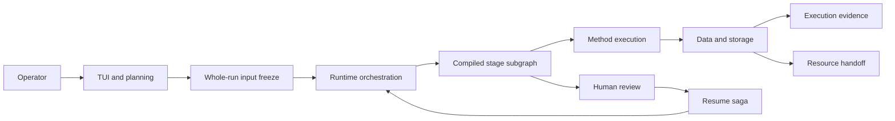

# Gene Agent Architecture Map

This directory is a graph of current design, not a linear manual. Start with
the question you are trying to answer, read one topic node, and follow only the
contract edges needed for that task.

The documentation has two disclosure layers:

- [`topics/`](topics/system-map.md) explains system behavior and how subsystems connect;
- [`reference/`](reference/data-contract.md) owns exact contracts, schemas, invariants, and
  conformance boundaries.

Folder placement controls reading depth, not dependency direction. Every topic
declares what feeds it, what it feeds, and which reference contracts own its
precise rules.

## System graph

Two distinct freeze boundaries appear in that graph. The TUI freezes the
manifest, run configuration, and dependency snapshot for the whole run.
Executable methods later freeze one exact attempt before a `Runner` may start
it. Do not collapse these lifecycles.

## Topic router

| Question | Start here | Follow when needed |
|---|---|---|
| What is the whole system? | [`topics/system-map.md`](topics/system-map.md) | Runtime, data, and stage contracts linked from that page |
| Which graph nodes, methods, and parameter flows are actually implemented? | [`topics/langgraph-implementation-map.md`](topics/langgraph-implementation-map.md) | Builders, registry, focused tests, and conformance links named by each status row |
| How does a user request become a run? | [`topics/tui-and-planning.md`](topics/tui-and-planning.md) | [`topics/runtime-orchestration.md`](topics/runtime-orchestration.md), frozen data contract |
| How does the parent graph route work? | [`topics/runtime-orchestration.md`](topics/runtime-orchestration.md) | Stage contracts and review/resume |
| How is a command frozen, run, and collected? | [`topics/execution.md`](topics/execution.md) | Execution lifecycle and evidence references |
| Where does each fact live? | [`topics/data-and-storage.md`](topics/data-and-storage.md) | Data, resource, and evidence references |
| How do human gates resume safely? | [`topics/review-and-resume.md`](topics/review-and-resume.md) | Data contract and runtime orchestration |
| How are method parameters proposed and approved? | [`topics/parameter-recommendation.md`](topics/parameter-recommendation.md) | Parameter and execution references |
| What does bootstrap own? | [`topics/bootstrap.md`](topics/bootstrap.md) | Descriptor and governance references |
| How does the AutoHiC path differ? | [`topics/autohic.md`](topics/autohic.md) | Parameter, execution, and resource contracts |
| Can the TUI start from clean reads or an assembly? | [`topics/tui-midstage-entry.md`](topics/tui-midstage-entry.md) | Planned behavior; current limitations are explicit |

## Reference registry

Read these only when a task needs the exact contract.

| Contract owner | Owns |
|---|---|
| [`reference/data-contract.md`](reference/data-contract.md) | Run ownership, durable fact placement, checkpoint bounds, artifact refs, ledger/report authority, retention, and crash rules |
| [`reference/execution-lifecycle.md`](reference/execution-lifecycle.md) | Freeze/run/collect graph, attempt owners, recovery routing, and stage-adapter boundary |
| [`reference/execution-evidence.md`](reference/execution-evidence.md) | Runtime result versus durable process evidence and log refs |
| [`reference/resource-handoff.md`](reference/resource-handoff.md) | Logical cross-stage resources, resolver priority, and FOFN boundary |
| [`reference/parameter-recommendation.md`](reference/parameter-recommendation.md) | Exact model DTO, schema-3 evidence, sparse response, approval, and retry semantics |
| [`reference/stage-contracts.md`](reference/stage-contracts.md) | Biological stage inputs, outputs, registered method roles, and review triggers |
| [`reference/descriptors.md`](reference/descriptors.md) | Package and method capability metadata |
| [`reference/governance.md`](reference/governance.md) | Source-of-truth, change-control, and quality-gate policy |
| [`reference/conformance.md`](reference/conformance.md) | Explicit gaps between accepted design and the current working tree |

## Status vocabulary

- **implemented**: the linked code and tests implement the documented boundary;
- **planned**: accepted design that is not yet available in the current product;
- **conformance-debt**: accepted contract and implementation currently differ.

A topic must not describe planned behavior as implemented. A reference contract
must not silently absorb an implementation exception; record the gap in
[`reference/conformance.md`](reference/conformance.md).

The finer-grained `wired`, `executable`, `partial`, `placeholder`, and `absent`
labels belong only to the maintained
[`LangGraph implementation map`](topics/langgraph-implementation-map.md). They
classify current nodes and methods without replacing the three topic/contract
statuses above.

## Loading rules

1. Start here and select one topic from the router.
2. When implementation maturity matters, check the LangGraph implementation
   map before assuming that a compiled stage or registered descriptor is a
   complete executable capability.
3. Read adjacent topics only when the current page names them as an incoming or
   outgoing edge.
4. Load a reference page only when exact fields, paths, ownership, or invariants
   matter to the task.
5. Verify behavior claims against the `Code evidence` paths on the topic page.
6. Update the single owning reference, the implementation map when its status
   changes, and every affected edge in the same
   change.

Git history retains superseded designs and implementation records. The working
tree keeps current topics, accepted planned nodes, explicit conformance debt,
and operational documentation only.
