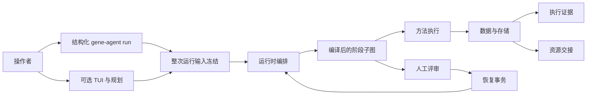

# Gene Agent 架构地图

本目录是当前设计的关系图，不是线性手册。从要回答的问题出发，选择一个专题，只沿任务所需的契约关系继续阅读。

架构入口首先提供两个互补索引：

- [`topics/system-map.md`](topics/system-map.md)：系统职责和最短完整运行流程。
- [`langgraph-implementation-map.md`](langgraph-implementation-map.md)：当前图节点、方法、参数流程、验证与欠账状态。

详细文档分为两层：

- [`topics/`](topics/system-map.md)：解释系统行为与子系统连接。
- [`reference/`](reference/data-contract.md)：维护精确契约、schema、不变量与一致性边界。

目录位置决定阅读深度，不决定依赖方向。每个专题声明输入来源、输出对象以及精确规则的权威参考契约。实现地图是本导航旁的跨领域状态投影，既不是专题，也不是契约权威。

## 系统关系图

图中包含两个独立冻结边界：结构化公共 `run` 入口和可选 TUI 都会冻结整次运行的 manifest、运行配置和依赖快照；随后，可执行方法在 `Runner` 启动前冻结某一次精确尝试。不可混淆这两个生命周期。

## 专题导航

| 问题 | 入口 | 按需继续 |
|---|---|---|
| 整个系统是什么？ | [`topics/system-map.md`](topics/system-map.md) | 该页链接的运行时、数据与阶段契约 |
| 结构化文件或 TUI 请求如何成为一次运行？ | [`topics/tui-and-planning.md`](topics/tui-and-planning.md) | [`topics/runtime-orchestration.md`](topics/runtime-orchestration.md)、冻结数据契约 |
| 父图如何路由？ | [`topics/runtime-orchestration.md`](topics/runtime-orchestration.md) | 阶段契约与评审/恢复 |
| 命令如何冻结、执行和收集？ | [`topics/execution.md`](topics/execution.md) | 执行生命周期与执行证据 |
| 每种事实存放在哪里？ | [`topics/data-and-storage.md`](topics/data-and-storage.md) | 数据、资源与证据契约 |
| 人工关卡如何安全恢复？ | [`topics/review-and-resume.md`](topics/review-and-resume.md) | 数据契约与运行时编排 |
| 方法参数如何提出并获批？ | [`topics/parameter-recommendation.md`](topics/parameter-recommendation.md) | 参数与执行契约 |
| bootstrap 负责什么？ | [`topics/bootstrap.md`](topics/bootstrap.md) | 描述符与治理契约 |
| AutoHiC 路径有什么不同？ | [`topics/autohic.md`](topics/autohic.md) | 参数、执行与资源契约 |
| TUI 能从 clean reads 或组装开始吗？ | [`topics/tui-midstage-entry.md`](topics/tui-midstage-entry.md) | 显式入口模式、材料验证及统一冻结 |

## 参考契约注册表

仅在需要精确契约时阅读这些文档。

| 权威契约 | 职责 |
|---|---|
| [`reference/data-contract.md`](reference/data-contract.md) | 运行所有权、生命周期事实身份与唯一性、共享进度归约、checkpoint 边界、产物引用、Ledger/报告权威、保留与崩溃规则 |
| [`reference/execution-lifecycle.md`](reference/execution-lifecycle.md) | 整次运行的执行就绪、freeze/run/collect 图、尝试所有权与终态、方法处置、恢复路由和阶段适配器边界 |
| [`reference/execution-evidence.md`](reference/execution-evidence.md) | 运行时结果与持久进程证据、日志引用的区别 |
| [`reference/resource-handoff.md`](reference/resource-handoff.md) | 当前逻辑资源、不可变组装交付、解析优先级、Read QC 谱系和 FOFN 边界 |
| [`reference/shared-facts.md`](reference/shared-facts.md) | 跨阶段生物学事实、基因组大小解析优先级、规划事实收集与冲突行为 |
| [`reference/recommendation-policy.md`](reference/recommendation-policy.md) | Assembly 方法/路线与参数推荐各自独立的 advisor/baseline 模式 |
| [`reference/parameter-recommendation.md`](reference/parameter-recommendation.md) | 精确模型 DTO、schema-3 证据、稀疏响应、审批和重试语义 |
| [`reference/casepack.md`](reference/casepack.md) | Assembly v5 案例消费：活动目录、精简的来源方法证据、跨方法检索与软件解释 |
| [`reference/stage-contracts.md`](reference/stage-contracts.md) | 生物阶段输入/输出、阶段结果与方法处置、注册方法角色、QC 事实与评审触发条件 |
| [`reference/descriptors.md`](reference/descriptors.md) | 软件包与方法能力元数据 |
| [`reference/governance.md`](reference/governance.md) | 权威来源、变更控制与质量门禁政策 |
| [`reference/conformance.md`](reference/conformance.md) | 已接受设计与当前工作树之间的明确缺口 |

## 状态词汇

- **已实现（implemented）**：链接的代码和测试实现了所述边界。
- **规划中（planned）**：已接受的设计，当前产品尚不可用。
- **一致性欠账（conformance-debt）**：已接受契约与实现仍有差异。

专题不得将规划中的行为描述为已实现。参考契约不得静默吸收实现例外，应将缺口记录到 [`reference/conformance.md`](reference/conformance.md)。

更细的 `wired`、`executable`、`partial`、`placeholder` 和 `absent` 标签仅用于持续维护的 [LangGraph 实现地图](langgraph-implementation-map.md)，用于分类当前节点和方法，不替代上述三种专题/契约状态。

## 阅读规则

1. 从本页开始，再读系统地图理解职责，读 LangGraph 实现地图理解当前成熟度。
2. 从导航中选择受影响的子系统专题。
3. 编译了阶段或注册了描述符，不代表能力已完整可执行；检查实现地图中的节点、方法和证据。
4. 仅在当前页列出相关输入或输出关系时阅读相邻专题。
5. 需要精确字段、路径、职责或不变量时再加载参考契约。
6. 根据专题页和实现地图的“代码证据”路径核实行为声明。

维护与同步规则由[架构治理](reference/governance.md)定义。
