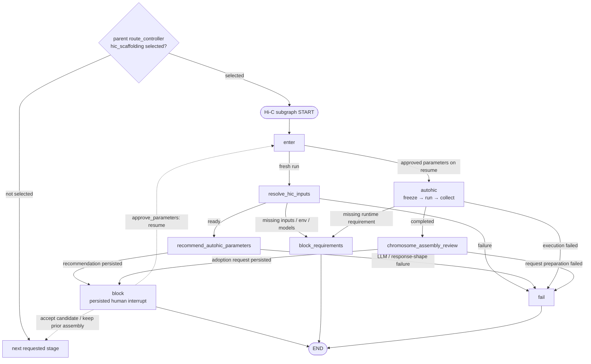

# AutoHiC Hi-C Stage Architecture

**Status:** Accepted; implemented

**Accepted:** 2026-07-15

**Scope:** Parent-graph ownership, the AutoHiC-only Hi-C stage, and its
parameter-recommendation gate

## 1. Decisions

1. AutoHiC is the only Hi-C scaffolding method. Gene Agent does not present a
   one-item method-selection gate.
2. The parent graph decides whether `hic_scaffolding` was selected. When it was
   not selected, the parent advances to the next requested stage without
   entering the Hi-C subgraph.
3. When Hi-C was selected, the stage resolves its required inputs and proceeds
   with AutoHiC. Missing required inputs block the stage; an attempted AutoHiC
   run that does not complete is a stage failure.
4. `select_hic_mode` and `write_hic_skip` are removed. The stage has no local
   skip/no-op branch.
5. AutoHiC gets a parameter recommender node following the existing assembly
   parameter-recommendation pattern.
6. The recommender uses the LLM to directly recommend the restriction enzyme.
   Every recommendation requires human approval before execution.
7. Parameter approval and final chromosome-assembly adoption remain separate
   review gates.

## 2. Parent and Stage Boundary

| Owner | Responsibility |
|---|---|
| Parent graph | Read `requested_stages`; enter or bypass `hic_scaffolding`; advance between biological stages |
| Hi-C stage | Resolve the adopted contig assembly and Hi-C reads; recommend AutoHiC parameters; run AutoHiC; review and adopt or reject its result |
| AutoHiC method subgraph | Execute the approved AutoHiC plan and collect its outputs |

The parent does not inspect Hi-C reads, restriction enzyme, model paths, or
AutoHiC results. Those facts matter only after the user has selected the stage.

The stage needs only these exceptional terminal conditions:

- `blocked_missing_requirements`: the stage was selected but required inputs or
  runtime configuration are missing;
- `failed`: AutoHiC execution was attempted and failed.

Not selecting Hi-C is a parent route decision, not a Hi-C stage result.

## 3. Target Graph

The solid edges below are the nodes and routes compiled by
`app/stages/hic_scaffolding/builder.py`. Dashed edges are review/resume actions
applied by the parent lifecycle after a persisted human decision.



There is deliberately no `select_hic_mode`, `write_hic_skip`, method picker, or
YaHS node in the compiled subgraph.

The stable method ID `hic_scaffolding.candidate.autohic` remains on descriptors,
recommendations, attempts, artifacts, and ledger events. It is an execution
identity, not evidence that method selection still exists.

## 4. AutoHiC Parameter Recommender

### 4.1 Contract

The node is named `recommend_autohic_parameters`. It runs after AutoHiC has
already been fixed as the method and before any execution plan is frozen.

It follows the assembly parameter-recommendation loop:

```text
build full input profile and immutable basis
  -> construct the strict model-facing DTO directly
  -> render and persist the exact model request
  -> call LLM for a parameter recommendation
  -> validate the recommendation
  -> persist the recommendation
  -> require human approval
  -> freeze the approved parameters for execution
```

The LLM directly recommends `restriction_enzyme`. The recommendation may use
explicitly allowlisted manifest facts, Hi-C library facts, read information,
and the supported-enzyme catalog supplied in the DTO. File locators, session
identity, artifact metadata, and unrestricted library metadata are audit facts,
not model input. Every proposal requires human approval.

Even when the manifest already contains a restriction enzyme, the recommender
still produces a proposal and every proposal goes through human approval. A
user correction produces a new recommendation using the same lifecycle as the
assembly parameter gate.

### 4.2 Other AutoHiC configuration

The first version exposes no other LLM-recommended parameters:

| Configuration | Source |
|---|---|
| `restriction_enzyme` | LLM recommendation plus mandatory human approval |
| AutoHiC, Juicer, 3D-DNA, Python, and model paths | `config/envs.yaml` and environment resolution |
| CPU/threads | execution resource settings |
| edit rounds, correction flags, and error thresholds | project-pinned AutoHiC defaults |
| assembly, R1/R2, species name, and output paths | resolved or derived run inputs |

This keeps the recommendation surface small while preserving the same approval,
resume, response-parsing, and artifact contracts already used by assembly. It does
not introduce a Hi-C-specific persistence contract or change
[`data-v2.md`](data-v2.md).

## 5. Stage Outputs and Adoption

AutoHiC is expected to produce the chromosome-level FASTA, `.hic`, `.assembly`,
HTML report, and the execution evidence needed for review. The final review gate
chooses between:

- adopting the AutoHiC chromosome-level assembly for downstream stages;
- keeping the previously adopted contig-level assembly.

Rejecting an AutoHiC result is a reviewed adoption decision. It is not a skip
mode and does not reintroduce method selection.

## 6. Implementation Changes

1. Remove `select_hic_mode`, `write_hic_skip`, the one-item candidate list, and
   the method-selection review path.
2. Route directly from resolved Hi-C inputs to
   `recommend_autohic_parameters`.
3. Reuse the shared recommendation persistence, response parsing, approval, resume, and frozen
   attempt contracts for the AutoHiC restriction-enzyme proposal.
4. Keep missing-requirement blocking separate from AutoHiC execution failure.
5. Update tests to cover parent bypass, missing requirements, mandatory
   parameter approval, execution failure, and final assembly adoption.
