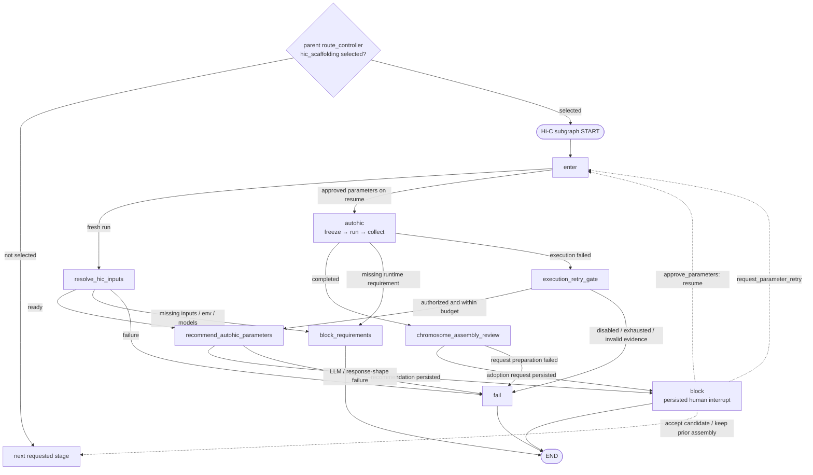

# AutoHiC Hi-C Stage Architecture

**Scope:** Parent-graph ownership, the AutoHiC-only Hi-C stage, and its
parameter-recommendation gate

## 1. Current Contract

1. AutoHiC is the only Hi-C scaffolding method. Gene Agent does not present a
   one-item method-selection gate.
2. The parent graph decides whether `hic_scaffolding` was selected. When it was
   not selected, the parent advances to the next requested stage without
   entering the Hi-C subgraph.
3. When Hi-C was selected, the stage resolves its required inputs and proceeds
   with AutoHiC. Missing required inputs block the stage; an attempted AutoHiC
   run that does not complete is a stage failure.
4. The stage has no local method-selection or skip/no-op branch.
5. AutoHiC uses the shared parameter-recommendation and approval contracts.
6. The recommender returns an attempt-local sparse mapping from the complete
   adjustable AutoHiC L2 catalog. The mapping may be empty, and every
   shape-valid recommendation requires human approval before execution.
7. Parameter approval and final chromosome-assembly adoption remain separate
   review gates.
8. Execution-failure retry is controlled by operator policy and budget. Final
   adoption review may request a fresh parameter attempt. Neither path merges
   the previous mapping into the new recommendation.

## 2. Parent and Stage Boundary

| Owner | Responsibility |
|---|---|
| Parent graph | Read `requested_stages`; enter or bypass `hic_scaffolding`; advance between biological stages |
| Hi-C stage | Resolve the adopted contig assembly and Hi-C reads; recommend AutoHiC parameters; run AutoHiC; review and adopt or reject its result |
| AutoHiC method subgraph | Execute the approved AutoHiC plan and collect its outputs |

The parent does not inspect Hi-C reads, restriction enzyme, model paths, or
AutoHiC results. Those facts matter only after the user has selected the stage.

The stage needs only these exceptional terminal conditions:

- `blocked_missing_requirements`: the stage was selected but required inputs or
  runtime configuration are missing;
- `failed`: AutoHiC execution was attempted and failed.

Not selecting Hi-C is a parent route decision, not a Hi-C stage result.

## 3. Stage Graph

The solid edges below are the nodes and routes compiled by
`app/stages/hic_scaffolding/builder.py`. Dashed edges are review/resume actions
applied by the parent lifecycle after a persisted human decision.



The compiled subgraph has no method-selection or local skip branch.

The stable method ID `hic_scaffolding.candidate.autohic` remains on descriptors,
recommendations, attempts, artifacts, and ledger events. It is an execution
identity, not evidence that method selection still exists.

## 4. AutoHiC Parameter Recommender

### 4.1 Contract

The node is named `recommend_autohic_parameters`. It runs after AutoHiC has
already been fixed as the method and before any execution plan is frozen.

It follows the assembly parameter-recommendation loop:

```text
build full input profile and immutable basis
  -> construct the strict model-facing DTO directly
  -> render and persist the exact model request
  -> call LLM for a parameter recommendation
  -> validate the recommendation
  -> persist the recommendation
  -> require human approval
  -> freeze the approved parameters for execution
```

The LLM returns only AutoHiC parameters that should be set explicitly for the
current attempt. The mapping may contain any subset of the adjustable catalog,
including no keys. It may use explicitly supplied species facts, bounded Hi-C
library facts, and chronological evidence from earlier attempts. File locators,
session identity, artifact metadata, unrestricted library metadata, runtime
paths, threads, retry policy, and model locations are audit/executor facts, not
model input. Every shape-valid proposal requires human approval.

An explicitly supplied restriction enzyme is an L1 fact. If the sparse L2
mapping omits it, freeze uses that fact; if both are absent, the post-approval
executability check blocks. A retry receives ordered, bounded prior-attempt
evidence but creates a fresh mapping with no inheritance, patch, or delta rule.

### 4.2 Other AutoHiC configuration

| Configuration | Source |
|---|---|
| `restriction_enzyme` | supplied L1 fact and/or approved sparse L2 override |
| `number_of_edit_rounds` | approved sparse L2 override or executor default |
| `translocation_adjust`, `inversion_adjust`, `debris_adjust` | approved sparse L2 overrides or executor defaults |
| `error_max_epoch`, `error_min_len`, `error_max_len` | approved sparse L2 overrides or executor defaults |
| `error_filter_score`, `error_filter_iou_score` | approved sparse L2 overrides or executor defaults |
| AutoHiC, Juicer, 3D-DNA, Python, and model paths | `config/envs.yaml` and environment resolution |
| CPU/threads | execution resource settings |
| assembly, R1/R2, species name, and output paths | resolved or derived run inputs |

Executor defaults are materialized separately in frozen evidence and are never
added to the recommendation or approval payload. The workflow preserves the
same approval, resume, response-parsing, and artifact contracts used by
Assembly and does not introduce a Hi-C-specific attempt schema.

## 5. Stage Outputs and Adoption

AutoHiC is expected to produce the chromosome-level FASTA, `.hic`, `.assembly`,
HTML report, and the execution evidence needed for review. The final review gate
chooses between:

- adopting the AutoHiC chromosome-level assembly for downstream stages;
- keeping the previously adopted contig-level assembly;
- requesting a fresh parameter attempt with the current report, contact map,
  assembly file, scaffold FASTA, and reviewer notes as immutable evidence.

Rejecting an AutoHiC result is a reviewed adoption decision. It is not a skip
mode and does not reintroduce method selection.

## 6. Current State Contract

Resolved Hi-C inputs route directly to `recommend_autohic_parameters`. Initial,
execution-failure retry, and review-failure retry tasks use the same sparse
response, persistence, approval, resume, and frozen-attempt contracts. Missing
requirements produce a blocked-requirement outcome. A failed execution is
sealed and either stops or creates a new recommendation according to explicit
operator retry policy and budget. These outcomes do not share a skip or
method-selection branch.

The AutoHiC stage cursor owns `current_parameter_attempt_id` and the compact
`parameter_attempts` chain. Each `ParameterAttempt` owns its own
`frozen_attempt_ref` and `execution_ref`; there is no parallel
`autohic_frozen_attempt_ref` or `autohic_execution_result` cursor.
Predecessors are sealed before retry, later attempts use attempt-specific work
and published-output paths, and checkpoint state keeps only compact refs rather
than model bodies, logs, or effective configs.
