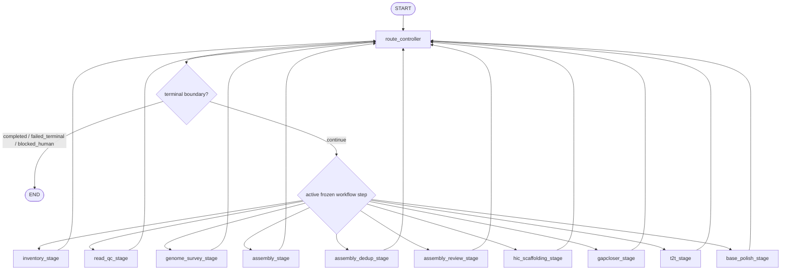

# LangGraph Implementation Map

> **Status:** current implementation map, with partial and debt units marked
> explicitly.
> **Read when:** determining which graph nodes, method routes, parameter flows,
> and review boundaries actually exist before changing or extending a stage.
> **Comes from:** frozen workflow occurrences, compiled graph builders, descriptor
> registry, method adapters, focused tests, and architecture conformance review.
> **Feeds into:** implementation planning, code review, method onboarding, and
> updates to the exact architecture contracts.
> **Contract dependencies:** [Runtime orchestration](topics/runtime-orchestration.md),
> [Stage contracts](reference/stage-contracts.md),
> [Descriptors](reference/descriptors.md),
> [Parameter recommendation](reference/parameter-recommendation.md), and
> [Architecture conformance](reference/conformance.md).
> **Code evidence:** `app/workflow.py`, `app/graph/`, every
> `app/stages/*/builder.py`, `app/execution/`, `descriptors/registry.yaml`, and
> the focused test files named below.

This page answers a narrower question than the
[system map](topics/system-map.md): **what is wired, executable, verified, partial, or
absent in the current tree?** It is not a roadmap or a historical progress log.
Exact behavioral rules remain owned by the linked reference contracts.

## How to read status

A compiled stage is not automatically a completed capability. Each unit is
classified on four independent axes.

| Axis | Values | Interpretation |
|---|---|---|
| Wiring | `wired`, `unwired`, `not-applicable` | Reachability through a graph edge, conditional route, or registered method route |
| Implementation | `executable`, `implemented-no-process`, `partial`, `placeholder`, `absent` | Real runner path, deliberate non-process behavior, incomplete boundary, named shell without a closed loop, or no modeled unit |
| Verification | `tested`, `partially-tested`, `untested` | Presence of focused tests that exercise the claim; this is not a claim that every repository quality gate is currently green |
| Debt | `none`, `known-gap`, `contract-drift` | No recorded limitation, bounded product limitation, or mismatch recorded in the conformance register |

`Not required` is a capability decision, not a failure status. For example,
Inventory does not need an LLM parameter recommender. `Placeholder` means a
named interface or graph position exists without an executable closed loop;
`absent` means there is no canonical stage, registered method, or graph
contract at all.

## Parent graph

The parent graph is a controller loop, not an unconditional linear pipeline.
At freeze, the ordered RunConfig occurrences become immutable `workflow_steps`:
implicit inventory is `step-000-inventory`, and every requested occurrence gets
a position-derived `step_id`. On each visit, the controller selects the active
frozen occurrence and advances exactly one position after completion. A stage
that is absent from that sequence is not skipped at runtime. Repeated stage
names remain distinct occurrences. `STAGE_ORDER` supports registration, default
recommendations, and display; it does not determine runtime order.
Pre-freeze sequence analysis never auto-inserts Review or rejects a literal
sequence merely because Review is absent. Each explicit Review step is bound to
its exact nearest earlier assembly-handoff occurrence through `review_target`.

There are no direct parent edges from one biological stage to the next. Every
compiled stage returns to `route_controller`. Stage subgraphs own biological
selection and evidence; the parent wrapper also records Ledger stage/session
events and writes blocked or failed operator reports.

| Parent unit | Wiring | Implementation | Verification | Debt | Evidence |
|---|---|---|---|---|---|
| `route_controller` and `route_from_current_stage` | `wired` | `implemented-no-process` | `tested` | `none` | `app/graph/routing.py`; `tests/test_graph_routing.py`, `tests/test_routing_contracts.py` |
| Frozen workflow-occurrence routing | `wired` | `implemented-no-process` | `tested` | `none` | `app/control/workflow_plan.py`, `app/graph/routing.py`; `tests/test_graph_routing.py`, `tests/test_routing_contracts.py` |
| Review occurrence placement policy | `wired` | `implemented-no-process` | `tested` | `none` | RunConfig preserves optional literal Review placement; sequence analysis binds only explicit Review occurrences. Deterministic, manifest, and LLM planning use the editable complete recommendation with Gap Closing, Base Polishing, and finish Review. `app/workflow.py`, `app/schemas/run_config.py`, `app/entrypoints/tui_intake.py`, `app/entrypoints/ask_planner.py`; `tests/test_run_config.py`, `tests/test_workflow_plan.py`, `tests/test_tui_intake.py`, `tests/test_ask_plan.py` |
| Manual-only GapCloser/Base Polish placeholder boundary | `wired` | `placeholder` | `tested` | `known-gap` | A reached frozen occurrence fails closed with a strict cursor; `app/stages/gapcloser/`, `app/stages/base_polish/`; `tests/test_placeholder_stages.py` |
| SQLite/memory checkpoint selection and durable resume | `wired` | `implemented-no-process` | `tested` | `none` | `app/graph/checkpointer.py`, `app/control/lifecycle.py`; `tests/test_checkpointer.py`, `tests/test_durable_resume.py` |
| Foreground review countdown policy | `wired` | `implemented-no-process` | `tested` | `none` | Frozen `RunConfig.review_policy` defaults to 300 seconds and allows only registry-backed stage overrides. `-1` waits; `0` and positive expiry normalize only a gate's eligible automatic request. The resulting request follows the same typed intent, durable preparation, verified application, and recovery protocol as a manual decision. Countdown applies only in the original attached executor with real stdin/stdout TTYs; re-executing an already-blocked checkpoint and later review/resume remain manual with no daemon, inferred deadline, strict/auto mode, or public timeout override. `app/review/application.py`, `app/control/resume_transaction.py`, `app/review/approval.py`; `tests/test_review_application.py`, `tests/test_foreground_review_countdown.py`, `tests/test_parameter_persistence_v2.py` |
| Authoritative terminal finalization, reporting, and checkpoint compaction | `wired` | `implemented-no-process` | `tested` | `known-gap` | `finalize_authoritative_terminal()` proves the checkpoint before recording the singleton terminal Ledger fact, then compacts best-effort. Reports run through `ProjectionBoundary` and cannot alter lifecycle authority. Report regeneration remains the bounded gap in [conformance](reference/conformance.md). `app/control/lifecycle.py`, `app/control/projections.py`, `app/graph/checkpoint_compaction.py`; `tests/test_terminal_finalizer.py`, `tests/test_projections.py`, `tests/test_checkpoint_compaction.py` |

## Cross-cutting implementation boundaries

These boundaries apply across multiple stage graphs. This table identifies the
implemented owner and verification surface; the linked reference document owns
the exact behavioral contract.

| Boundary | Current implementation | Code and test evidence | Contract owner |
|---|---|---|---|
| Public structured-run preflight and whole-run freeze | `gene-agent run --manifest PATH --run-config PATH --data-dir PATH` canonicalizes and validates source files, requires real stdin/stdout TTYs before freeze, requires an explicit ordered `requested_stages` list of `{stage, allow_local_execution}` objects, rejects `requested_stages: null`, freezes that literal occurrence sequence and dependency snapshot without requiring or inserting Review, then projects it into immutable `workflow_steps` for SQLite execution. Every explicit Review receives an exact earlier assembly-handoff `review_target`. Inventory registers an `assembly_fasta_registered` asset as a resource; public preflight does not reorder or rewrite occurrences by registry order. Each reached stage validates its own inputs. A confirmed TUI draft checks the same TTY boundary and uses the same freeze/executor. | `app/entrypoints/run.py`, `app/entrypoints/tui.py`, `app/schemas/run_config.py`, `app/workflow.py`, `app/storage/frozen_inputs.py`, `app/control/workflow_plan.py`; `tests/test_run_command.py`, `tests/test_tui.py`, `tests/test_workflow_plan.py`, `tests/test_frozen_inputs.py`, `tests/test_configuration_examples.py` | [Runtime orchestration](topics/runtime-orchestration.md), [Data contract](reference/data-contract.md) |
| Attached and detached progress | The executor passes one ephemeral controller-transition renderer into the existing parent graph; it reads the frozen occurrence cursor only after the corresponding Ledger facts are committed. `inspect --json` schema 1 joins the verified frozen plan, occurrence-qualified Ledger events, checkpoint evidence, and the local advisory lock without creating a progress store or lock file. Invalid frozen inputs make plan-derived fields unavailable, and repeated stage names remain distinct by `workflow_step_id`. | `app/graph/builder.py`, `app/entrypoints/run.py`, `app/control/lifecycle.py`, `app/storage/frozen_inputs.py`; `tests/test_graph_routing.py`, `tests/test_run_command.py`, `tests/test_review_resume.py` | [Runtime orchestration](topics/runtime-orchestration.md), [Data contract](reference/data-contract.md) |
| Verified frozen context and trace authority | Production run and resume validate one frozen transaction and pass its in-memory `FrozenInputBundle` into the Inventory subgraph. Inventory validation/registration consume its canonical manifest, RunConfig, declarations, and paths; no production disk-reload fallback remains. Trace derives workflow steps from a freshly validated bundle, otherwise only occurrence-bearing Ledger/artifact facts. | `app/entrypoints/run.py`, `app/graph/builder.py`, `app/stages/inventory/nodes.py`, `app/reports/trace_writer.py`; `tests/test_frozen_inputs.py`, `tests/test_run_trace.py`, `tests/test_resource_resolution.py` | [Runtime orchestration](topics/runtime-orchestration.md), [Data contract](reference/data-contract.md) |
| Occurrence integrity at execution, Ledger, and resources | Before recovery or Runner invocation, the shared lifecycle rejects a frozen attempt whose step ID is missing or differs from the active occurrence. Every runtime Ledger envelope carrying `stage` requires a step ID; only run-level `session_terminal` is an explicit diagnostic exception. `ResourceRef` requires `source_stage` and `workflow_step_id` to be jointly present or absent. | `app/execution/lifecycle.py`, `app/storage/ledger.py`, `app/schemas/resource_ref.py`, `app/execution/env_dispatch.py`; `tests/test_execution_lifecycle.py`, `tests/test_ledger_v2.py`, `tests/test_resource_resolution.py` | [Execution lifecycle](reference/execution-lifecycle.md), [Data contract](reference/data-contract.md), [Resource handoff](reference/resource-handoff.md) |
| Interactive Inventory-only planning | Ask/TUI distinguish an unanswered selection (`None`) from an explicit empty occurrence list. Plain-text, questionary, and LLM Plan Draft paths accept `[]`, skip biological planning questions, render `Inventory only`, and freeze `requested_stages: []`. | `app/schemas/ask_plan.py`, `app/entrypoints/ask_interactive.py`, `app/entrypoints/tui.py`; `tests/test_ask_plan.py`, `tests/test_ask_interactive.py`, `tests/test_tui.py` | [TUI and planning](topics/tui-and-planning.md), [Runtime orchestration](topics/runtime-orchestration.md) |
| Current assembly candidate continuity | T2T and Hi-C adoption publish a derived executed candidate with the exact adopted primary artifact and decision-artifact identity. Their no-patch/keep-prior decisions preserve bytes and candidate relation but republish the central `ResourceRef` under the active occurrence. Assembly Review verifies that ref's producer provenance against its frozen `review_target` before consuming the single current-candidate contract. | `app/storage/assembly_candidates.py`, `app/stages/t2t/nodes.py`, `app/stages/hic_scaffolding/nodes.py`, `app/stages/assembly_review/`; `tests/test_assembly_candidate_bundle.py`, `tests/test_t2t.py`, `tests/test_hic_scaffolding.py`, `tests/test_assembly_review.py` | [Resource handoff](reference/resource-handoff.md), [Stage contracts](reference/stage-contracts.md) |
| Stage resource resolution | Stage adapters query canonical `ResourceSpec` objects through `resource_resolution.py`. There is no separate repository planning-preflight API or duplicate stage-requirement table. The confirmed-run boundary performs read-only machine readiness for the canonical effective method closure before whole-run freeze; method-attempt input/resource validation still occurs at frozen-attempt construction. | `app/execution/run_readiness.py`, `app/stages/resource_specs.py`, `app/stages/resource_resolution.py`; `tests/test_run_readiness.py`, `tests/test_project_scaffold.py`, stage-focused tests | [Resource handoff](reference/resource-handoff.md) |
| Genome Survey logical inputs | The stage boundary exposes only `short_reads` and `long_reads`, prefers the short-read family, and leaves clean/raw lifecycle priority to each resource spec. No-read execution is permitted only when an explicit genome size supports the documented skip path. | `app/stages/genome_survey/nodes.py`, `app/stages/genome_survey/state.py`, `app/stages/resource_specs.py`; `tests/test_genome_survey.py`, `tests/test_genome_size.py` | [Stage contracts](reference/stage-contracts.md) |
| Executable artifact dependencies | Genome Survey k-mer products cross the Jellyfish/GenomeScope2 boundary as indexed `ArtifactRefJson` values. The consumer has no path-string upgrade branch. | `app/stages/genome_survey/method_application/jellyfish.py`, `genomescope2.py`; `tests/test_genome_survey.py` | [Data contract](reference/data-contract.md) |
| Descriptor loading | Registry, package, method, planner, IO, conditional-requirement, and resource-hint YAML models reject undeclared keys. The committed registry loads as 14 retained, typed method records. | `app/schemas/descriptors.py`; `tests/test_configuration.py` | [Descriptors](reference/descriptors.md) |
| Registered execution classes | The registry is partitioned into 13 `local` methods bound to imported lifecycle/graph objects and one `planner_only` method whose real route is proven to launch no process. | `tests/test_registry_executable_invariant.py`, `descriptors/registry.yaml` | [Descriptors](reference/descriptors.md) |
| AutoHiC output collection | After process success and before the first new publication, collection requires all four frozen products or matching attempt-local indexed recovery records. Missing products fail collection; a later publication failure may leave an indexed orphan without success semantic events. | `app/stages/hic_scaffolding/method_application/support.py`; `tests/test_hic_scaffolding.py` | [AutoHiC](topics/autohic.md), [Stage contracts](reference/stage-contracts.md) |

## Stage node inventory

These rows classify concrete node groups. Nested method nodes are expanded in
the method inventory rather than being hidden inside one stage-level color.

### Inventory and input preparation

| Stage node or capability group | Wiring | Implementation | Verification | Debt | Evidence |
|---|---|---|---|---|---|
| Inventory `enter -> validate_inputs -> register_assets -> commit` | `wired` | `implemented-no-process` | `tested` | `none` | The executor injects verified frozen inputs into both Inventory validation and registration; a missing bundle fails before Inventory effects. Registered external assembly assets receive an Inventory-produced executed candidate and occurrence-bound Ledger fact. `app/stages/inventory/builder.py`, `app/stages/inventory/nodes.py`; `tests/test_inventory.py`, `tests/test_frozen_inputs.py`, `tests/test_resource_resolution.py` |
| Inventory `review_gate` and `fail` boundaries | `wired` | `implemented-no-process` | `tested` | `none` | `app/stages/inventory/builder.py`; `tests/test_inventory.py`, `tests/test_review_resume.py` |
| Read QC `enter`, `resolve_raw_long_reads`, planning, `commit`, `fail` | `wired` | `implemented-no-process` | `tested` | `none` | `app/stages/read_qc/builder.py`; `tests/test_read_qc.py` |
| Read QC `seqkit_stats` nested method node | `wired` | `executable` | `tested` | `none` | `app/stages/read_qc/method_application/seqkit_stats.py`; `tests/test_read_qc.py` |
| Read QC `seqkit_length_filter` nested method node, including intentional skip | `wired` | `executable` plus `implemented-no-process` skip | `tested` | `none` | `app/stages/read_qc/method_application/seqkit_length_filter.py`, `app/stages/read_qc/nodes.py`; `tests/test_read_qc.py` |
| Genome Survey input resolution and `select_survey_mode` | `wired` | `implemented-no-process` | `tested` | `none` | Stage-owned `short_reads | long_reads` resolution and explicit-size skip; `app/stages/genome_survey/nodes.py`, `app/stages/resource_specs.py`; `tests/test_genome_survey.py`, `tests/test_genome_size.py` |
| Genome Survey `jellyfish -> genomescope2` method chain | `wired` | `executable` | `tested` | `none` | Indexed k-mer `ArtifactRefJson` handoff with no string compatibility branch; `app/stages/genome_survey/method_application/`; `tests/test_genome_survey.py` |
| Genome Survey `write_full_survey_result`, explicit-prior skip, `commit`, `fail` | `wired` | `implemented-no-process` | `tested` | `none` | `app/stages/genome_survey/builder.py`; `tests/test_genome_survey.py`, `tests/test_genome_size.py` |

### Assembly production, review, and chromosome finishing

| Stage node or capability group | Wiring | Implementation | Verification | Debt | Evidence |
|---|---|---|---|---|---|
| Assembly input/profile route: `resolve_extended_inputs -> infer_input_profile -> select_route` | `wired` | `implemented-no-process` | `tested` | `none` | `app/stages/assembly/builder.py`; `tests/test_assembly.py`, `tests/test_multiplatform_long_reads.py` |
| Assembly selection: `build_assembly_candidate_set -> select_primary` | `wired` | `implemented-no-process` | `tested` | `none` | `app/stages/assembly/nodes.py`; `tests/test_assembly.py`, `tests/test_assembly_candidate_bundle.py` |
| Assembly `recommend_parameters` and mandatory approval block | `wired` | `implemented-no-process` model/evidence workflow | `tested` | `known-gap` | Formal schema-3 flow is implemented; method-specific knowledge coverage is uneven; `tests/test_parameter_recommendation_v3_contract.py`, `tests/test_phase11_parameter_approval.py` |
| Assembly `flye`, `nextdenovo`, `hifiasm`, `hifiasm_ont` nested method nodes | `wired` | `executable` | `tested` | method-specific below | `app/stages/assembly/method_application/`; `tests/test_assembly.py` |
| Assembly `execution_retry_gate`, `commit`, `fail`, `block` | `wired` | `implemented-no-process` | `tested` | `none` | `app/stages/assembly/parameters/workflow.py`, `app/stages/assembly/routing.py`; `tests/test_phase11_parameter_approval.py`, `tests/test_review_resume.py` |
| Dedup `enter -> plan -> purge_dups -> commit/fail` | `wired` | `executable` | `tested` | `none` | `app/stages/assembly_dedup/`; `tests/test_assembly_dedup.py` |
| Assembly Review reusable subgraph, candidate resolution, and `quast -> busco` metrics | `wired` | `executable` | `tested` | `none` | Callers supply an executed current `AssemblyCandidateBundle` plus the central `assembly` `ResourceRef`; candidate loading verifies its `source_stage` and `workflow_step_id` against the Review step's exact frozen `review_target`, with no bare `fasta_path` bypass or Hi-C/T2T-specific fallback. Repeated Review occurrences remain step-scoped. `app/stages/assembly_review/`, `app/storage/assembly_candidates.py`; `tests/test_assembly_review.py`, `tests/test_assembly_candidate_bundle.py` |
| Assembly Review rule, review-owned parameter-quality, related-species, comparison nodes | `wired` | `implemented-no-process` | `tested` | `none` | Parameter-quality diagnosis remains in the active `assembly_review` occurrence; it records no Assembly retry cursor or parameter evidence and continues to related-species/human review. `app/stages/assembly_review/nodes.py`; `tests/test_phase10_parameter_catalog.py`, `tests/test_related_species_evidence.py`, `tests/test_related_species_statistics.py`, `tests/test_assembly_review_statistics_integration.py` |
| Assembly Review `human_gate` and adoption/resume transaction | `wired` | `implemented-no-process` | `tested` | `none` | `app/stages/assembly_review/builder.py`, `app/control/resume_transaction.py`; `tests/test_review_resume.py` |
| Hi-C `resolve_hic_inputs` and requirement boundary | `wired` | `implemented-no-process` | `tested` | `none` | `app/stages/hic_scaffolding/`; `tests/test_hic_scaffolding.py` |
| Hi-C `recommend_autohic_parameters` and approval/retry gates | `wired` | `implemented-no-process` model/evidence workflow | `tested` | `none` | `app/stages/hic_scaffolding/parameters/`; `tests/test_hic_scaffolding.py`, `tests/test_parameter_resolution_validation.py` |
| Hi-C `autohic` nested method node and collection | `wired` | `executable` | `tested` | `none` | Real runner plus fail-closed validation of FASTA, `.hic`, `.assembly`, and HTML, including replay and late-publication failure coverage; `app/stages/hic_scaffolding/method_application/`; `tests/test_hic_scaffolding.py` |
| Hi-C `chromosome_assembly_review`, block, and adoption resume | `wired` | `implemented-no-process` | `tested` | `none` | An accepted scaffold publishes a decision-identified derived candidate; keep-prior preserves the existing bytes/candidate relation and republishes the central `ResourceRef` under the active Hi-C occurrence. `app/stages/hic_scaffolding/builder.py`, `app/stages/hic_scaffolding/nodes.py`; `tests/test_hic_scaffolding.py`, `tests/test_assembly_candidate_bundle.py`, `tests/test_review_resume.py` |
| GapCloser parent placeholder | `wired` | `placeholder` | `tested` | `known-gap` | Manual-only route position and strict fail-closed cursor; no method, artifact, or resource handoff; `app/stages/gapcloser/`; `tests/test_placeholder_stages.py` |
| T2T input and motif chain: `resolve_inputs -> resolve_telomere_motif` | `wired` | `implemented-no-process` with conditional model call | `tested` | `none` | `app/stages/t2t/parameters/workflow.py`; `tests/test_t2t_motif.py` |
| T2T threshold recommendation, approval, and `prepare_parameters` | `wired` | `implemented-no-process` model/evidence workflow | `tested` | `none` | `app/stages/t2t/parameters/`; `tests/test_t2t.py`, `tests/test_parameter_recommendation_v3_contract.py` |
| T2T scans and minimap2 alignment | `wired` | `executable` | `tested` | `none` | `scan_assembly`, `prepare_reads`, `scan_reads`, `alignment`; `app/stages/t2t/nodes.py`; `tests/test_t2t.py` |
| T2T patch, validation, report, adoption gate, commit/fail | `wired` | `implemented-no-process` | `tested` | `none` | A changed adopted patch verifies the current candidate, publishes a decision-identified derived candidate with the patched primary artifact, then replaces the resource; no-patch keeps the bytes/candidate relation and republishes the central `ResourceRef` under the active T2T occurrence. `apply_patches`, `validate_patched`, `report`, `gate_review`; `app/stages/t2t/nodes.py`; `tests/test_t2t.py`, `tests/test_assembly_candidate_bundle.py`, `tests/test_review_resume.py` |
| Base Polish parent placeholder | `wired` | `placeholder` | `tested` | `known-gap` | Manual-only route position and strict fail-closed cursor; no method, artifact, or resource handoff; `app/stages/base_polish/`; `tests/test_placeholder_stages.py` |

## Registered method inventory

`descriptors/registry.yaml` currently contains 14 registered methods. Thirteen
declare `execution_kind: local`; the executable invariant binds each ID to an
imported lifecycle, nested method graph, and outer stage node. The sole
`planner_only` method is an intentional no-process choice whose real
planner-to-stage route is tested. There are currently **no descriptor-only
placeholder methods in the registry**. Descriptor loading is strict at the
registry and every nested YAML model boundary.

| Registered method | Descriptor | Adapter/lifecycle | Collection | Verification | Debt or limitation |
|---|---|---|---|---|---|
| `read_qc.long_read_stats.seqkit_stats` | registered | `executable` | implemented | `tests/test_read_qc.py` | none |
| `read_qc.length_filter.seqkit_seq` | registered | `executable` | implemented | `tests/test_read_qc.py` | requires explicit approved `min_len` |
| `read_qc.length_filter.skip` | registered | `implemented-no-process` (`planner_only`) | not applicable | `tests/test_read_qc.py`, `tests/test_ask_plan.py` | deliberate raw-read pass-through |
| `genome_survey.kmer_count.jellyfish` | registered | `executable` | implemented | `tests/test_genome_survey.py` | typed k-mer artifact publication |
| `genome_survey.model.genomescope2` | registered | `executable` | implemented | `tests/test_genome_survey.py` | typed k-mer artifact dependency |
| `assembly.candidate.flye` | registered with catalog | `executable` | implemented | `tests/test_assembly.py`, `tests/test_configuration.py` | none |
| `assembly.candidate.hifiasm` | registered with catalog | `executable` | implemented | `tests/test_assembly.py`, `tests/test_hifiasm_evidence_case.py` | richest current literature case coverage |
| `assembly.candidate.hifiasm_ont` | registered with catalog | `executable` | implemented | `tests/test_assembly.py`, `tests/test_hifiasm_numeric_retrieval.py` | structured guidance exists; numeric case corpus is Hifiasm-centered |
| `assembly.candidate.nextdenovo` | registered with catalog | `executable` | implemented | `tests/test_assembly.py` | catalog exists; no equivalent literature case corpus |
| `assembly_dedup.purge_dups` | registered | `executable` | implemented | `tests/test_assembly_dedup.py` | none |
| `assembly_review.eval.quast` | registered | `executable` | implemented | `tests/test_assembly_review.py` | stage-local review, not final integrated QA |
| `assembly_review.eval.busco` | registered | `executable` | implemented | `tests/test_assembly_review.py` | requires operator-provided offline lineage provenance |
| `hic_scaffolding.candidate.autohic` | registered with catalog | `executable` | implemented | `tests/test_hic_scaffolding.py` | all four review products are mandatory at collection |
| `t2t.alignment.minimap2` | registered with catalog | `executable` | implemented | `tests/test_t2t.py` | none |
`tests/test_registry_executable_invariant.py` derives local IDs from imported
`MethodExecutionLifecycle` bindings, proves those bindings cover exactly the 13
registered local methods, and verifies each shared freeze/run/collect and outer
stage route. It derives the planner-only set from the production planner catalog
and exercises `read_qc.length_filter.skip` through raw-read commit while proving
that no filter frozen attempt, runner call, or method-scoped attempt event is
created. The two sets are disjoint and their union equals the complete registry.

## Parameter capability map

Parameter capability is not one Boolean. Catalog, recommendation, approval,
freeze binding, retry, and biological knowledge coverage are separate facts.

| Scope | Static catalog | Recommendation and immutable evidence | Human approval | Frozen-attempt binding | Retry | Current limitation |
|---|---|---|---|---|---|---|
| Assembly: Flye | implemented | implemented | mandatory | implemented | implemented | catalog present; no method-specific literature case corpus comparable to Hifiasm |
| Assembly: Hifiasm | implemented | implemented | mandatory | implemented | implemented | current evidence retrieval is concentrated here |
| Assembly: Hifiasm-ONT | implemented | implemented | mandatory | implemented | implemented | structured Hifiasm guidance exists; numeric cases remain Hifiasm-centered |
| Assembly: NextDenovo | implemented | implemented | mandatory | implemented | implemented | catalog present; no equivalent literature case corpus |
| AutoHiC | implemented | implemented | mandatory | implemented | implemented | collection fail-closes on a missing declared product; terminal collect failure has no automatic retry |
| T2T/minimap2 thresholds | implemented | implemented after motif resolution | mandatory | implemented | initial recommendation only | no T2T parameter-retry route |
| GapCloser / Base Polish | no registered method | not implemented | not applicable | no executable attempt | not applicable | parent-only placeholders fail closed when explicitly requested |
| Read QC, Survey, Dedup, Review | method/run configuration | not implemented as formal recommenders | not applicable | normal run-config freeze | not applicable | do not label these as stale recommenders |
| Inventory | not required | not required | input ambiguity review only | not applicable | not applicable | no recommender should be inferred |

The formal schema-3 recommendation chain for Assembly, AutoHiC, and T2T is
implemented. The remaining gap is not “parameter recommendation is missing
everywhere”; it is that method-specific biological knowledge depth is uneven
and most other stages deliberately use static/operator configuration.

## Product capabilities without a registered executable method

Some items now have an explicit parent position without an executable closed
loop. `placeholder` means the graph can represent and fail the request
truthfully; it does not mean the biological capability runs.

| Product capability | Wiring | Implementation | Verification | Debt | Exact current boundary |
|---|---|---|---|---|---|
| Gap closing after chromosome scaffolding | `wired` | `placeholder` | `tested` | `known-gap` | The accepted complete recommendation places `gapcloser` between Hi-C Scaffolding and T2T. Its parent subgraph currently has only a strict not-implemented cursor and skip/failure evidence; it has no method descriptor, executable adapter, artifact contract, or central assembly handoff |
| Automated base polishing | `wired` | `placeholder` | `tested` | `known-gap` | The accepted complete recommendation places `base_polish` after T2T. Its current parent-only boundary has no NextPolish, Racon, Medaka, Pilon, or other executor and publishes no polished central assembly handoff |
| Finish Review after Base Polish | recommended placement is wired; Base Polish handoff is not | `implemented-no-process` Review after a placeholder position | `partially-tested` | `known-gap` | Planners place the reusable `assembly_review` after Base Polish. Until Base Polish implements the central handoff, frozen nearest-producer binding remains on T2T and execution terminates at the Base Polish placeholder before reaching Review; implementing Base Polish moves the binding to that producer |
| TUI midstage entry from clean reads or an existing assembly | `unwired` in the public TUI | `placeholder` as accepted design | `partially-tested` | `known-gap` | See [TUI midstage entry](topics/tui-midstage-entry.md) |

The finish Review is a second occurrence of the reusable `assembly_review`
stage, not a separate “final QA” stage. The Base Polish placeholder or an
operator-provided polished assembly must not be counted as an automated
polishing method.

## Maintenance rule

Follow this synchronization order for behavior changes: update code, then the
unique owning reference contract, each affected topic, and this map when its
wiring, status, evidence, or debt projection changes. Update `docs/README.md`
or the architecture router only when navigation relationships change.

Update this page in the same change whenever code adds, removes, or rewires any
of the following:

- a parent graph node or canonical stage;
- a stage builder node or conditional route;
- a registered method or planner execution kind;
- a method adapter, collection contract, or registered execution-class invariant;
- a parameter catalog, recommender, approval gate, retry, or attempt binding;
- a human review gate or cross-stage resource commit;
- a conformance entry cited by a status row.

Every new `tested` label must name focused test evidence. Closed gaps disappear
from this map in the same change that removes their conformance entry.
Historical states belong in Git history; do not append phase logs or completion
percentages here.
