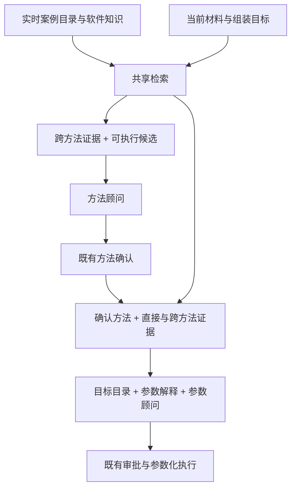

# Assembly 案例消费与推荐

> **状态：** Assembly 消费者已实现；生物学结果验证另行进行。
>
> **范围：** Assembly 方法选择与参数推荐。Hi-C/T2T 工作流及推荐器已实现；本契约当前只覆盖 Assembly 案例消费，Hi-C/T2T 案例内容尚未纳入。
>
> **职责：** 案例交换、材料查询、检索、软件解释，以及两项 Assembly 决策共享的文献依据。
>
> **相关契约：** [推荐策略](recommendation-policy.md)、[参数推荐](parameter-recommendation.md)、[资源交接](resource-handoff.md)、[一致性](conformance.md)。

## 推荐目标

针对当前样本、可用数据和预期输出，推荐有用的首个组装方法及配置。顾问结合已报告案例经验、软件机制和自身领域知识。匹配案例或受控方法比较不是提出推荐的前提；存在匹配比较时可增强偏好。建议偏好不是已测性能排名或校准成功概率。

消费者围绕唯一案例来源和唯一检索服务运行。既有执行、审批和不可变参数尝试基础设施继续由原所有者负责。

## 案例交换与生产者边界

生产者保留 `assembly-extraction.v5` 作为执行事实图，为独立完整的 `recommendation-cases.v1` 论文包供图。交付的案例 JSON 文件是唯一维护的案例库：身份、`parameter_eligible`、观测、报告测量、来源定位共存于每个案例。来源复核的修正直接更新案例，不维护并行资格表、案例选择列表或补充回放文件。部署验证后的案例文件本身。编辑或复制到活动目录前，先完成进行中的推荐并暂停新推荐/重试；完整更新通过加载器后再恢复。目录读取不是原子案例库快照。

`scripts/build_assembly_cases.py` 是新 Assembly 案例的可选一次性导入工具。调用者选择绑定来源步骤、输入和测量，每个案例必须显式提供 `parameter_eligible`；没有仓库全局选择或资格后备。导入到独立暂存目录，复核后加入活动库；不同的现有内容禁止覆盖。重新导出原图不能用于恢复后来案例修正。

一篇论文含零个或多个案例。案例表示已识别样本或明确样本组，使用特定方法配置完成特定组装任务。跨样本共用配置仍可识别。单位是一次 Assembly 操作，不是 Assembly/Hi-C/T2T 工作流。直接用于组装器分相的 Hi-C 是 Assembly 支持输入；后续 scaffolding 和 T2T 动作不是本操作设置。紧凑视图保留报告动作、输入角色/目的、直接输出。绝不按工具名推断模式。结果根据明确图绑定标记 `direct_output`、`downstream_context`、`mixed_context` 或 `unknown`；下游测量不代表单独组装器性能。

导出选择必须明确绑定材料测量。`features` 将规范特征键映射为测量规格，多次报告则为规格列表；每项声明 `measurement`、规范 `unit`，重复/冲突值不得覆盖。裸表格值的 `source_unit` 还要求 `unit_basis` 标明源表头/指标/上下文。界限和范围保持可读，不编造标量。复合测量可使用显式复核的 `component`，例如 `{"text": "subread N50 14,456 bp", "label": "subread N50"}`。文本必须是完整唯一来源分句，可选标签须匹配特征。规范化不任意搜数字，也不把文库大小当读长。每个 component 仍遵守原对象、样本、处理状态、排除检查，并在依据中保留完整原值。`reported_measurements` 可独立于数值索引选择仅来源的材料测量；规范化失败与明确排除保留原因。`input_states` 只绑定选定输入 ID，未知保持未知。选定下游结果保留附于被评估状态的缺口。

导出器打印案例/特征覆盖，并对全空数值索引发出警告。使用 `--filename-template '{paper}-response.json'` 可直接从 response 命名的 v5 图导出，无需复制；默认仍为 `{paper}.json`。

每个案例暴露以下信息：

| 信息 | 必需语义 |
|---|---|
| 论文与案例身份 | 稳定论文/案例身份及可获得标题、DOI、来源位置 |
| 任务与材料 | Assembly 操作、样本背景、直接输入及处理状态、输出意图 |
| 来源方法 | 明确软件名、已知时的报告版本与模式；区分主工具/支持工具角色 |
| 来源设置 | 源软件词汇中的名称、值或精确设置文本，包括 CLI 标志与配置键 |
| 匹配观测 | 样本/输入测量、单位、报告/派生来源、对象/平台/状态绑定和缺失信息 |
| 结果与用途 | 执行状态、路线角色、带评估对象和整流程归因的结果 |
| 限定条件 | 来源缺口、未解设置、抽取/复核范围 |

能支持组装器选择的软件案例需标明组装器；未知/人工操作可作支持上下文。未知版本或模式保持未知。案例软件名是来源身份，不是可执行 Gene Agent 方法 ID；`hifiasm` 加输入模式可映射不同方法。消费者从权威方法记录导出工具键，不维护第二份独立可编辑身份。

生产者不按目标消费者 L2 目录过滤设置。尤其目标是 hifiasm 时，NextDenovo 设置仍可使用。不识别设置保留可读源文本；没有识别出的可调整设置不是丢弃有用案例的理由。缺设置不变成默认值。基因组大小等源软件设置仍是配置观测，不是独立样本测量。

消费者读取案例契约，不导入生产者仓库或重建完整 v5 图。明确的离线投影从现有图构建完整交换格式，不得删除方法或设置以满足消费者。

案例内容是允许列表控制的推荐摘要，不是 v5 实体副本。保留样本背景、输入角色和处理范围、来源设置、评估对象标签、测量依据、评估条件、限制与来源定位。不得在输入、评估或结果中嵌入完整状态、步骤、方法或来源注册表。原图和引用论文仍是来源证据；复核的案例文件拥有交付推荐内容，含后来修正。

## 当前材料查询

方法推荐前构建一个 Assembly 材料查询，参数推荐复用；包含目标输出、样本/基因组事实、可用平台和资源绑定读段测量。资源限制仍由执行器拥有，不是案例匹配特征。缺失观测保持缺失。

读段测量标明实际输入资源、平台和处理状态。不能将单一 QC 汇总分配给每个可用平台。派生覆盖度保留读段总量和基因组大小依据。Raw/filtered、平均读长/N50、组装 N50/读段 N50、k-mer 估计/最终组装测量均保持区别。已知案例方法不能解决当前运行测量读段的身份。

方法决策使用可用资源；确认后参数决策还接收选定路线与读段类型。文件绑定留在执行器记录。它是同一观测材料的附加视图，不是新编造 profile。

## 检索

检索选择有用证据，顾问选择方法/配置。外部工具或不同平台不自动排除参考材料；可执行候选兼容性另行强制。平台、处理状态、目标输出、软件模式差异与相似性一并展示给模型。

初始实现使用确定性结构化匹配加紧凑案例文本词法检索，二者共用一个案例库。结构化匹配只比较已知可比观测；词法检索在案例文本（含动作/方法描述）上匹配样本背景。当前查询文本包含报告学名与 clade，不包含推断的困难标签。候选取并集后融合排名，保留各分量匹配及缺失特征覆盖供解释；不能把完整性或排名分数当生物学置信度。初期不要求 embedding 服务或额外模型重排器。

当前使用按 token 数规范化的重叠（不是 BM25）、结构化相对距离分数、加权倒数排名融合（材料 2、词法 1、阻尼 10）。可比观测必须匹配名称、单位、平台和处理状态。参数用途增加小幅同工具奖励（0.002），重复工具施加适度多样性惩罚（0.15）。准入要求正材料或词法相关性。可比但零相似特征是差异，不是匹配；非零匹配也未必完全一致。逐观测数值相似性与差异保持可见。未知读段处理状态不是 raw/filtered 通配符。默认最多五个完整案例、每个独立来源两个、任务专属 LLM 视图 32,000 个紧凑 JSON 字符；仅参数推荐包含设置和解释。同论文内共享配置去重。这些都是未经校准的检索启发式。

服务对配置的实时目录进行两种用途的选择：

| 用途 | 证据选择 |
|---|---|
| 方法选择 | 跨组装器广泛材料/任务匹配，保留相关软件/模式多样性；不按预选方法过滤 |
| 参数推荐 | 跨组装器材料/任务匹配，加确认方法的定向匹配与有用配置/机制案例 |

同方法案例提供直接上下文，外部方法案例解释可比问题如何解决。方法身份影响相关性和展示，不决定参考库准入。材料相似性弱的同方法案例不能自动挤走强外部案例。缺参数不抹除方法使用或失败经验。

实际执行的替代路线和 benchmark 分支可有信息价值，保留角色。仅描述的动作不能冒充实际结果。失败或未选结果是判断上下文，不能自动作为负例丢弃。

按完整任务案例视图及其限定和必要软件解释计预算，不截断设置或结果来塞入。完整审计记录不受提示词预算限制。共享配置和复用数据去重，限制论文集中度，在相关候选中考虑方法多样性。不要强制软件等额配额，或用无支持匹配填满预算。允许零文献匹配，仍提供当前事实与软件知识。

## 软件与参数解释

消费者拥有独立于单篇案例的可复用软件知识：任务/输入/输出能力、算法/模式上下文、设置含义。源案例拥有论文做了什么；软件解释拥有该设置控制什么。

每个检索设置的解释标明来源工具、版本范围、原生标志/配置键、值语义/单位、算法效果和相关交互。可执行目录元数据能真实解释时复用；必要时维护额外有引用的机制指导，包括当前适配器未暴露的设置。CLI 标志与配置键均需支持；未知语义保持未知，不伪造等价关系。

方法选择附紧凑方法描述。参数推荐把相关源设置解释放入 `source_method`，目标可调整目录/指导只在请求级放一次。不得在第二全局列表重复解释，或给每个案例附完整手册/目录。源解释仅限案例 `settings` 实际出现的原生标志/键。例如 hifiasm 目标下 NextDenovo 案例仅报告 `read_cutoff`、`nextgraph_a`，就只包含这两个解释，不加入 `threads`、`workdir`、输入绑定或完整目录。未知源设置逐字保留并标未知语义；不能以其他参数描述填补缺解释。目标 hifiasm 可调整目录保持独立，因为它定义合法输出。

跨方法推理可迁移问题解释或调参策略，并在语义与当前数据支持时提出目标工具值，但不能实现机械参数名/值翻译表。例如读段保留阈值可支持覆盖度推理；内部图控制必须先在自身算法中解释，再考虑目标设置。源 L0/L1 值可解释历史上下文，不能覆盖当前执行器绑定或样本事实。

## 决策顺序

两个顾问读取同一配置目录并共享材料事实；证据投影可不同，目录变化对下一次新推荐可见。方法确认后参数检索可增加定向案例；参数请求也保留方法决策理由与相关案例上下文。这使用既有两个决策边界，不增加第三次 LLM 检索/翻译调用。

方法未选时，高相关 NextDenovo 案例在顾问提出组装器前即可用。能力、当前数据、输出目标、案例/机制上下文支持时可推荐 NextDenovo，不要求案例通过成对实验证明其优越性；相关性本身也不会机械选择源软件。

任务明确限定 hifiasm 调参或 hifiasm 已确认时，NextDenovo 仍是参考证据。参数顾问只输出目标方法稀疏 L2，不能静默替换确认方法。改变方法必须是明确方法选择事务，不是参数重试。本契约不增加自动换方法循环或新 RunConfig 方法字段。

可执行候选来自已实现方法、支持的输入/模式绑定和可解析执行需求。有用参考方法未必本地可执行；模型必须区分参考工具与可用执行选择。候选 ID 附能力摘要。

## 实时目录、模型投影与所有权

案例来源可选：不配置意味着空文献证据加软件知识，不加载其他案例来源。每次新方法或参数推荐（包括参数重试）读取当前目录与软件知识。没有运行级案例副本、哈希、快照文件、冻结验证或目录缓存。不要求向生产者案例写审批标记或运行记录；初步抽取/复核范围仍是显式证据上下文。

`assembly.case_source` 配为 `recommendation-cases.v1` 交换 JSON 目录，路径相对运行配置解析，经 Assembly 种子传递。输入冻结不访问案例目录，不改变正常输入/控制文件。交换加载器拒绝未知 schema、重复身份、非常规/符号链接案例文件、超大载荷（每论文 8 MiB，总计 64 MiB）。

方法/参数模型请求包含有界可读证据及相关原因。存储路径和完整检索轨迹留在持久记录，不变成模型指令。每次尝试只记录选定证据和软件解释。新重试重读目录，同时保留确认方法、可执行目录、材料事实、有序尝试历史。恢复同一已记录请求使用原请求，不重新检索替换。它是正常推荐/审批证据，不是第二案例库。加载错误与真实空匹配必须可区分。

方法请求/响应恢复只有一个定位器 `_recover_assembly_method_artifact()`：使用 occurrence 局部确定性目标与共享 `recover_published_artifact()`，包括修复发布后未索引崩溃。响应绑定请求哈希。冲突记录或不符合当前定位与绑定契约的记录必须拒绝，应新建运行，不能静默重发。不得解析无关 occurrence。方法恢复复用记录的动作/方法允许列表与系统消息，不读当前 skill 文本。并发响应发布复用验证后的获胜者，这不保证外部模型调用 exactly-once。

参数尝试恢复共用存储原语。已记录参数请求复用精确消息/DTO 和目录，不重渲染模板或重投影证据；请求哈希绑定不可变输入和 basis。`validate_parameter_basis()` 为新请求和恢复共享；请求未绑定不可变输入和 basis 时拒绝，不能静默升级。提示词渲染与哈希共享 `parameter_prompt_bundle_name()`，方法到模板查找不在各路径独立实现。

边界明确为：完整案例/可追溯记录 → 检索评分字段 → 任务专属 LLM 视图。`retrieve_assembly_cases()` 返回完整选定案例，包括匹配观测、来源身份、设置解释。方法请求审计记录和参数 `basis_snapshot.json` 将其保留为 `knowledge_evidence`。

`project_method_choice_case()` 输出案例身份、源工具/版本/模式、报告操作及直接输入角色/目的/输出、样本特征、平台、观测、执行状态、路线角色、结果和匹配差异，排除来源设置与解释。`project_parameter_case()` 复用材料/结果投影，并添加带原生设置和 `setting_explanations` 的 `source_method`、`target_method`、`relation`（`same_tool` 或 `cross_method`）。参数视图替换短 `method` 对象，不重复身份。跨方法设置只作参考，不机械映射到目标标志或值。

报告测量组保留评估对象、依据、评估上下文，不带来源定位符。可比观测保留单位、对象、平台、处理状态、报告/派生来源。存在可读源分组时也保留：它可包含组合或无法规范化的量，不能安全地由数值检索索引替代。同一可读测量列表中，相同对象、依据、归因只输出一次并附 `metrics` 列表；共享上下文/评估上提到组，不同限定留在各指标。冲突值显式保留，不平均或选择性抹除。单样本对象标签只省略 `sample_traits` 已有的精确样本名片段，保留种类、范围、来源和区分后缀；多样本标签完整保留。自由文本不按长度裁切。

`scope_limit` 缺口合为一条抽取范围通知；冲突、缺源、缺事实、歧义链接保留完整限定。未知或多个路线角色显式保留。小型 `limitations` 列表保留来源范围/访问限制、缺口、规范化限制、归因说明；完整定位与后续线索留在审计记录。两个公共投影都是允许列表，新审计字段不能静默进入提示词。

模型只接收一次当前 `facts` 和小型材料范围上下文；查询文本、读段绑定、重复 raw QC/Survey 映射留在外部。

运行级案例副本、嵌套完整 v5 实体、重复模型事实属于重复表示。保留的每次尝试审批记录有独立生命周期，属于有意对称，不拥有案例库。完整审计案例与任务视图也是有意对称：共享材料/结果语义共同变化，任务专属设置独立。紧凑 `CaseContent` 禁止实体形额外字段和嵌套材料对象；回归测试约束边界与模型单份事实载荷。运行 `pytest -q tests/test_assembly_case_consumption.py` 检查简化不变量；`bash scripts/check_assembly_projection.sh` 还约束指定知识实现范围内零文本克隆。

| 所有者 | 职责 |
|---|---|
| `app/knowledge/` | 唯一案例契约、实时加载、检索、有界证据投影 |
| `app/domains/assembly/` | 当前材料查询、方法身份/能力映射、软件语义 |
| `app/stages/assembly/` | 方法选择前检索、绑定确认、持久各决策并复用证据 |
| `app/llm/` | 独立方法/参数请求和提示词；跨方法解释，但可执行输出仅针对目标 |
| 既有存储/评审/执行模块 | 不可变记录身份、审批、重试谱系、命令解析 |

## 当前要求与验收

活动案例目录使用 `recommendation-cases.v1` 交换格式；每个案例必须携带稳定身份、来源定位、Assembly 方法与原生设置、输入/结果对象、限定和明确的 `parameter_eligible`。加载、检索、请求、投影与 basis 绑定必须使用同一案例契约。案例目录只服务 Assembly；Hi-C/T2T 运行时推荐器已实现，但对应案例与文献方法知识不属于当前目录范围。

验收必须覆盖：

- 完整新论文案例（含方法与原生设置）经真实加载器、查询、检索、请求、渲染器和不可变 basis 全链保留。
- 材料接近的外部方法案例同时进入开放方法选择和目标参数推理，弱同方法案例不会总胜出。
- NextDenovo 配置键即使不在 hifiasm L2 目录也保留软件含义；目标执行仍拒绝外部键。
- 案例缺失/不均衡时可据现有材料与软件知识建议，不编造案例、观测或数值成功概率。
- 混合平台、raw/filtered 状态、来源设置与测量、共享配置、完整卡片预算保持区别。
- 目录编辑对新推荐/重试可见，历史请求不变；不向控制文件写案例库。参数重试保留确认方法、目录、材料事实；基线和审批保持既有契约。
- 生产 Assembly 只有一个消费者，缺少案例时使用当前材料与软件知识，不编造案例或参数证据；本契约不扩展 Hi-C/T2T 案例内容。

请求、投影、冻结输入、跨方法回归位于 `tests/test_assembly_case_consumption.py`；既有审批/重试测试覆盖事务边界。它们不是组装质量实验。软件解释目前覆盖目录标志/配置键和既有 hifiasm 机制指导，不覆盖全部历史设置。投影验证选定绑定，不验证完整生产图或原论文支持。当前缺口见[一致性](conformance.md#assembly-software-explanation-coverage)。
