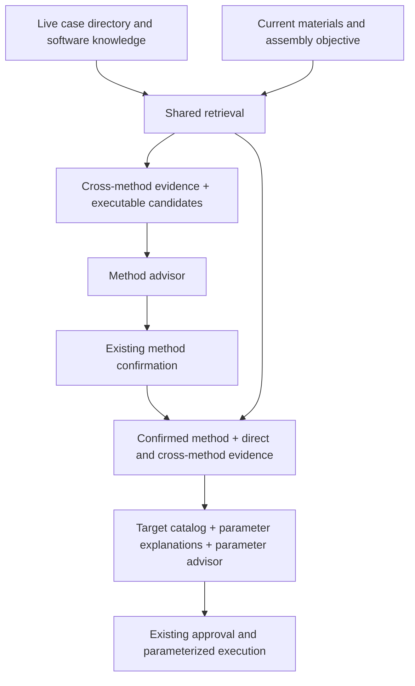

# Assembly Case Consumption and Recommendation

> **Status:** implemented Assembly consumer; biological outcome validation remains separate.
> **Scope:** Assembly method choice and parameter recommendation. Hi-C and T2T
> consumers are deferred.
> **Owns:** case exchange, material queries, retrieval, software explanations and
> the shared literature basis for the two Assembly decisions.
> **Related contracts:** [recommendation policy](recommendation-policy.md),
> [parameter recommendation](parameter-recommendation.md),
> [resource handoff](resource-handoff.md), and [conformance](conformance.md).

## Recommendation objective

Recommend a useful first assembly method and configuration for the current
sample, available data and intended output. The advisor combines reported case
experience, software mechanisms and its own domain knowledge. A matched case or
a controlled method comparison is not a prerequisite for making a recommendation.
Matched comparisons strengthen a preference when present. Suggested preferences
are not measured performance rankings or calibrated probabilities of success.

The consumer is rebuilt around one case source and one retrieval service. The
cutover replaces the old Assembly literature consumers; it does not add V1/V3/
pilot auto-detection, compatibility adapters, or a fallback to old case cards.
Existing execution, approval and immutable parameter-attempt infrastructure keep
their established owners.

## Case exchange and producer boundary

The producer retains `assembly-extraction.v5` as its execution-fact graph and
supplies graphs for self-contained `recommendation-cases.v1` paper packages.
The delivered case JSON files are the sole maintained corpus: identity,
`parameter_eligible`, observations, reported measurements and source locators
live together in each case. Corrections from source review update that case
in place; do not maintain a parallel eligibility table, corpus selection list,
or enrichment replay file. Deploy the validated case files themselves.
Before editing or copying into an active directory, finish in-flight
recommendations and pause new recommendations and retries. Resume only after
the complete update passes the case loader; directory reads are not atomic
corpus snapshots.

`scripts/build_assembly_cases.py` is an optional one-time import tool for new
Assembly cases. Its caller-supplied selection binds source steps, inputs and
measurements and must explicitly include `parameter_eligible` for every case.
It has no repository-global selection or eligibility fallback. Import into a
separate staging directory, review the resulting cases, then add them to the
active corpus. It refuses to overwrite different existing case content.
Re-exporting an original graph is not a way to restore later case corrections.
The older producer pilot exchange is not accepted by the runtime.
One paper contains zero or more cases. A case represents an identified sample or
explicit sample group using a particular method configuration for a particular
assembly task. Shared configurations remain identifiable across sample cases.
The unit is one Assembly operation, not an Assembly/Hi-C/T2T workflow case.
Hi-C reads directly used for assembler phasing are supporting Assembly inputs;
later scaffolding and T2T actions are not this operation's settings. Keep the
reported action, input roles/purpose and direct outputs in the compact view.
Never infer a mode from a tool name. Outcomes identify `direct_output`,
`downstream_context`, `mixed_context`, or `unknown` from explicit graph bindings;
downstream measurements are not assembler-only performance evidence.

An export selection must bind its material measurements explicitly. `features`
maps a canonical feature key to a measurement specification, or a list of
specifications when several measurements report that feature. Each specification
names `measurement` and the normalized `unit`; repeated/conflicting values are
never overwritten. For a bare table value, `source_unit` additionally requires
`unit_basis` identifying the source header/metric/context. Bounds and ranges stay
readable rather than becoming invented scalars. A compound measurement can use
an explicitly reviewed `component`, for example
`{"text": "subread N50 14,456 bp", "label": "subread N50"}`. The text must be one
complete, unique source clause; the optional label must match the feature.
Normalization never searches for an arbitrary number or treats library size as
read length. Each component still obeys the original object, sample, processing
state and exclusion checks, and retains the full original value in its basis.
`reported_measurements` can select source-only material measurements independently
of the numeric index. Failed normalization and explicit exclusions retain reasons.
`input_states` binds only selected input IDs; unknown states remain unknown.
Selected downstream outcomes retain gaps attached to their evaluated states.

The exporter prints case/feature coverage and warns on an entirely empty numeric
index. Use `--filename-template '{paper}-response.json'` to export directly from
response-named v5 graphs without copying them. The default remains `{paper}.json`.

Each case exposes the following information:

| Information | Required semantics |
|---|---|
| Paper and case identity | Stable paper/case identity and available title/DOI/source locations |
| Task and material | Assembly operation, sample background, direct inputs and their processing state, output intent |
| Source method | Explicit software name, reported version and mode when known; primary/supporting tool roles stay distinguishable |
| Source settings | Reported names, values or exact setting text in the source software's vocabulary, including CLI flags and configuration keys |
| Matching observations | Sample and input measurements, units, reported/derived origin, object/platform/state binding and missing information |
| Results and use | Execution status, route role, outcomes with their evaluated object and whole-workflow attribution |
| Qualifications | Source gaps, unresolved settings and extraction/review scope |

A software case eligible to inform assembler choice identifies its assembler;
unknown/manual operations can remain supporting context. Unknown version or
mode stays unknown. Case software names are source identities, not executable
Gene Agent method IDs. `hifiasm` plus its input mode can map to different executable
methods. Consumer indexes derive tool keys from the authoritative method record
rather than maintaining a second independently editable identity.

The producer does not filter settings against the target consumer method's L2
catalog. In particular, a NextDenovo setting remains available when the target is
hifiasm. Unrecognized settings remain readable source text. Lack of a recognized
adjustable setting is not a reason to discard an otherwise informative case.
Missing settings do not become defaults. Source software settings such as genome
size remain configuration observations, not independent sample measurements.

The consumer reads the case contract without importing the producer repository
or reconstructing the full v5 graph. The explicit offline projection builds
the new exchange from existing graphs. It does not merely relabel pilot/legacy
JSON or remove method/settings content to satisfy the consumer.

Case content is an allowlisted recommendation summary, not a copy of v5
entities. Preserve sample background, input roles and processing scope, source
settings, evaluated-object labels, measurement basis, assessment conditions,
limitations and source locators. Do not embed whole states, steps, methods or
source registries inside inputs, assessments or outcomes. The original graph and
cited paper remain source evidence; the reviewed case file owns the delivered
recommendation content, including later corrections.

## Current material query

One Assembly material query is built before method recommendation and reused for
parameter recommendation. It includes the target output, sample/genome facts,
available input platforms and resource-bound read measurements. Resource limits
remain executor-owned, not case-matching features. Missing observations stay missing.

Read measurements identify their actual input resource, platform and processing
state. A single QC aggregate is not assigned to every available platform.
Derived coverage retains its read-total and genome-size basis. Raw and filtered
reads, mean length and N50, assembly N50 and read N50, k-mer estimates and final
assembly measurements remain distinct. Knowing the case's method does not resolve
the identity of the current run's measured reads.

The method decision uses available resources; after confirmation the parameter
decision also receives the selected route and read type. File bindings remain
in executor records. This is an additional view of the same observed materials,
not a newly invented profile.

## Retrieval

Retrieval chooses useful evidence; the advisor chooses a method/configuration.
Neither a foreign tool nor a different input platform is a blanket exclusion
from reference material. Executable candidate compatibility is enforced separately.
Differences in platform, processing state, output target and software mode are
shown to the model alongside similarities.

Use deterministic structured matching plus lexical retrieval over compact case
text for the first implementation. Both are over one corpus. Structured matching
compares only commensurable known observations; lexical retrieval covers sample
background against case text (including actions and method descriptions).
Current query text contains the reported scientific name and clade, not inferred
difficulty labels. Union the candidate lists and fuse their ranks;
preserve the component matches and missing-feature coverage for interpretation.
Do not turn feature completeness or a ranking score into biological confidence.
An embedding service or an additional model reranker is not required initially.

The initial implementation uses token overlap normalized by token counts (not
BM25), structured relative-distance scores, and weighted reciprocal-rank fusion
(material 2, lexical 1; damping 10). Comparable observations must match name,
unit, platform and processing state. The parameter purpose adds a small same-tool
bonus (0.002); repeated tools receive a modest diversity penalty (0.15).
Admission requires positive material or lexical relevance. Comparable but
zero-similarity features are differences, not matches; a nonzero match need not
be exact. Numeric similarities and differences remain visible per observation.
Unknown read processing state is not a wildcard for raw/filtered measurements.
Defaults are five whole cases, two per independent source, and 32,000 compact
JSON characters of the task-specific LLM view, including settings and explanations
only for parameter recommendation. Shared configurations are
deduplicated within a paper. These are uncalibrated retrieval heuristics.

The service has two purpose-specific selections over the configured live directory:

| Purpose | Evidence selection |
|---|---|
| Method choice | Broad material/task matches across assemblers, with relevant software/mode diversity; no preselected-method filter |
| Parameter recommendation | Material/task matches across assemblers plus targeted matches for the confirmed method and useful configuration/mechanism examples |

Same-method examples provide direct context; foreign-method examples can explain
how a comparable assembly problem was handled. Method identity affects relevance
and presentation, not admission to the reference corpus. Same-method examples
with little material similarity cannot automatically displace a strong foreign
example. Missing parameters do not remove method-use or failure experience.

Performed alternatives and benchmark branches can be informative; retain their
roles. Described-only actions cannot stand in for performed results. Failed or
unselected outcomes are context for judgement rather than automatically discarded
negative examples.

Budget each whole task-specific case view together with its qualifications and
necessary software explanations; never truncate a setting or outcome to fit.
Full audit records are not prompt-budgeted. Deduplicate shared configurations and reused data, cap
concentration by paper, and consider method diversity among relevant candidates.
Do not require equal software quotas or fill the budget with unsupported matches.
Allow no literature matches while still supplying the current facts and software
knowledge to the advisor.

## Software and parameter explanations

The consumer owns reusable software knowledge separate from individual paper
cases. It covers task/input/output capabilities, algorithm/mode context and the
meaning of settings. The source case owns what the paper did; the software
explanation owns what that software setting controls.

For a retrieved setting, an explanation identifies its source tool and version
scope, native flag/config key, value semantics/unit, algorithmic effect and
relevant interactions. Reuse executable catalog metadata where it actually
explains those things. Maintain additional referenced mechanism guidance where
needed, including settings not exposed by the current execution adapter.
CLI flags and configuration keys both require support. Unknown semantics remain
unknown rather than receiving a fabricated equivalence.

Attach compact method descriptions at method choice. At parameter recommendation,
include explanations for relevant retrieved settings inside `source_method` and
the target method's adjustable catalog/guidance once at request level. Do not
repeat explanations in a second global list or append a tool's complete manual
or parameter catalog to every case.
Source explanations are restricted to native flags/config keys actually present
in that case's `settings`. For a hifiasm target and a NextDenovo case reporting
only `read_cutoff` and `nextgraph_a`, include only those two NextDenovo
explanations, not its `threads`, `workdir`, input bindings or full catalog.
Unknown source settings remain verbatim with unknown semantics; absence of an
explanation must not be filled with another parameter's description. The target
hifiasm adjustable catalog remains separate because it defines valid outputs.

Cross-method reasoning can transfer a problem interpretation or tuning strategy
and can propose a target-tool value when its semantics and current data support
that choice. It must not implement a mechanical parameter-name/value translation
table. For example, a read-retention cutoff can inform reasoning about retained
coverage; an internal graph control is interpreted in its own algorithm before
considering any target-tool setting. Source L0/L1 values may explain historical
context but never overwrite current executor bindings or sample facts.

## Decision sequence

Both advisors read the same configured directory and share material facts;
their evidence projections can differ and directory changes are visible to the
next new recommendation. Parameter retrieval may add targeted
cases after method confirmation. The parameter request
also retains the method decision's reasons and relevant case context. This uses
the existing two decision boundaries, not a third LLM retrieval/translation call.

When method choice is open, a highly relevant NextDenovo case is available before
the advisor proposes the assembler. The advisor can recommend NextDenovo if its
capabilities, current input data, output objective and case/mechanism context
support doing so. A case need not establish NextDenovo's superiority in a paired
experiment. Relevance alone also does not mechanically select its software.

When the task is explicitly scoped to tuning hifiasm, or hifiasm has been confirmed,
NextDenovo remains reference evidence. The parameter advisor emits only the
target method's sparse L2 mapping. It cannot silently replace the confirmed method.
Changing that decision is an explicit method-selection transaction, not parameter
retry. This contract does not add an automatic method-switch loop or a new
RunConfig method field.

The executable candidate set comes from implemented methods, supported input/mode
bindings and resolvable execution requirements. A useful reference method need not
be locally executable. The model must distinguish reference tools from available
execution choices. Candidate capability summaries accompany their IDs.

## Live directory, model projection and ownership

The single new source is optional: no source means empty literature evidence plus
software knowledge, not reactivation of an old case library. Each new method or
parameter recommendation, including parameter retries, reads the current case
directory and software knowledge. There is no run-level corpus copy, hash,
snapshot file, freeze validation or case-directory cache.
It does not require an approval marker or run record to be written into producer
cases. Preliminary extraction/review scope remains explicit evidence context.

Configure `assembly.case_source` as a directory of exchange JSON files; paths are
resolved relative to the run config and passed through the Assembly seed.
Input freezing does not access the case directory; normal input/control files
are unchanged. The exchange loader
rejects old schemas, duplicate identities, non-regular/symlink case files and
oversized payloads (8 MiB per paper, 64 MiB total).

Method and parameter model requests contain bounded readable evidence and the
reason for relevance. Storage paths and full retrieval traces
remain in durable records rather than becoming instructions for the model.
Each attempt records only its selected evidence and software explanations.
New retries reread the directory while retaining the confirmed method, executable
catalog, material facts and ordered attempt history. Recovering the same already
recorded request uses that request, not a newly retrieved replacement. This is
ordinary recommendation/approval evidence, not a second case library.
Case loading errors and an honest empty match remain distinguishable.

Method request/response recovery has one locator,
`_recover_assembly_method_artifact()`: use deterministic occurrence-local request
and response destinations with shared `recover_published_artifact()`, including
repair of publication-before-index crashes. Responses bind the request hash.
Conflicting records and older content-addressed method records fail closed; start
a new run instead of silently redispatching. Unrelated occurrences are not resolved.
Method recovery reuses the recorded action/method allowlists and system message,
not current skill text. A competing response publication reuses the verified
winner; this is not an exactly-once external model-call guarantee.
Parameter-attempt recovery uses the same storage primitive. A recorded parameter
request reuses its exact messages/DTO and catalog, without rerendering templates or
reprojecting evidence; request hashes bind the immutable input and basis artifacts.
`validate_parameter_basis()` is shared by new requests and recovery. Unbound older
requests fail closed rather than being silently upgraded.
Prompt rendering and hashing share `parameter_prompt_bundle_name()`; their method
to-template lookup is not independently implemented in each path.

The boundary is explicit: complete case / traceable record → retrieval and
scoring fields → task-specific LLM view. `retrieve_assembly_cases()` returns full
selected case records, including matching observations, source identity and
setting explanations. Method request audit records and parameter
`basis_snapshot.json` retain these records as `knowledge_evidence`.

`project_method_choice_case()` emits case identity, source tool/version/mode,
the reported operation and its direct input roles/purpose and outputs,
sample traits, platforms, observations, execution status, route roles, outcomes
and match differences. It excludes source settings and their explanations.
`project_parameter_case()` reuses the same material/outcome projection and adds
`source_method` with native settings and `setting_explanations`, `target_method`
and `relation` (`same_tool` or `cross_method`). The parameter view replaces the
short `method` object rather than repeating its identity. Cross-method settings
are references, never mechanically mapped to target flags or values.

Reported measurement groups keep their evaluated objects, basis and assessment
context, without source locators. Comparable observations retain units, object,
platform, processing state and reported/derived origin. Readable source groups
also remain when present: they can include combined or unnormalizable quantities
and cannot safely be replaced by the numeric retrieval index.
Within each readable measurement list, identical objects, basis and attribution are emitted
once with a `metrics` list. Shared context/assessment is hoisted to the group;
different qualifications remain on their individual metrics. Conflicting values
remain explicit, never averaged or selected away. In single-sample cases, object
labels omit only exact sample-name segments already present in `sample_traits`;
kind, scope, origin and distinguishing suffixes remain. Multi-sample labels remain
intact. No free text is cut by length.
`scope_limit` gaps become one extraction-scope notice; conflicts, missing sources,
missing facts and ambiguous links retain their complete qualification.
Unknown or multiple route roles remain explicit. A small `limitations` list keeps
source scope/access limits, gap issues, normalization caveats and attribution notes; full
evidence locators and follow-up leads stay in audit records. The two public
projections are allowlists, so new audit fields cannot silently enter prompts.

The model receives current `facts` once and a small material-scope context.
Query text, read bindings and duplicate raw QC/survey mappings stay outside it.

These are duplicate representations: run-level corpus copies, nested full v5
entities, and repeated model facts. The retained per-attempt approval records
have an independent lifecycle (intentional symmetry), not library ownership.
Full audit cases and task-specific views are also intentional symmetry: shared
material/outcome semantics move together, while task-only settings remain separate.
The compact `CaseContent` contract forbids entity-shaped extras and nested
material objects; regression tests enforce that boundary and the single-facts
model payload. Run `pytest -q tests/test_assembly_case_consumption.py` to check
these simplification invariants; `bash scripts/check_assembly_projection.sh`
also enforces zero text clones in the scoped knowledge implementation.

| Owner | Responsibility |
|---|---|
| `app/knowledge/` | One case contract, live loading, retrieval and bounded evidence projection |
| `app/domains/assembly/` | Current-material query, method identity/capability mapping and software semantics |
| `app/stages/assembly/` | Retrieve before method choice, bind confirmation, persist each decision and reuse its evidence |
| `app/llm/` | Separate method/parameter requests and prompts; cross-method interpretation with target-only executable outputs |
| Existing storage/review/execution modules | Immutable record identity, approval, retry lineage and command resolution |

## Cutover and acceptance

The rebuilt Assembly path replaces the V1 case API, V3 facts consumer, old
hifiasm numeric/card projection and their Assembly runtime selection branches.
Audit other callers before deleting shared pack utilities used outside Assembly.
Retain useful execution catalogs and move reusable method guidance under its new
owner. Do not import old cases automatically or keep legacy readers as fallback.
Source papers and unrelated user data are not cleanup targets.

Existing persisted runs are not converted or silently resumed through new
semantics. Affected pre-cutover checkpoints fail explicitly at the compatibility
boundary; preserving old record files does not require retaining multiple live
recommendation implementations. Shared attempt-record schemas need not change
solely because their literature payload changes.

Acceptance must cover:

- A complete new paper case, including method and native settings, survives the
  real loader, query, retrieval, request, renderer and immutable basis path.
- A materially close foreign-method case reaches both open method choice and
  target-method parameter reasoning; a weak same-method case does not always win.
- A NextDenovo configuration key is retained with its software meaning even when
  absent from the hifiasm L2 catalog; target execution still rejects foreign keys.
- Missing/uneven case coverage allows advice from available material and software
  knowledge, without fabricated cases, observations or numeric success probabilities.
- Mixed input platforms, raw/filtered states, source-setting versus measurement
  provenance, shared configurations and complete-card budgets remain distinct.
- Directory edits are visible to new recommendations and retries; historical
  request records remain unchanged. No corpus is written into control files.
  Parameter retry preserves the confirmed method, catalog and material facts;
  baseline and approval paths retain their existing contracts.
- The production Assembly path has one consumer implementation and no old-source
  fallback. Hi-C and T2T behavior is unchanged by this scoped rebuild.

The request, projection, frozen-input and cross-method regressions are in
`tests/test_assembly_case_consumption.py`, with existing approval/retry tests
covering unchanged transaction boundaries. They are not assembly-quality
experiments. Software explanations currently cover catalog flags/config keys
and existing hifiasm mechanism guidance, not every historical tool setting.
Projection validates selected bindings, not the complete producer graph or
its original-paper support. Current gaps are recorded in
[conformance](conformance.md#assembly-software-explanation-coverage).
