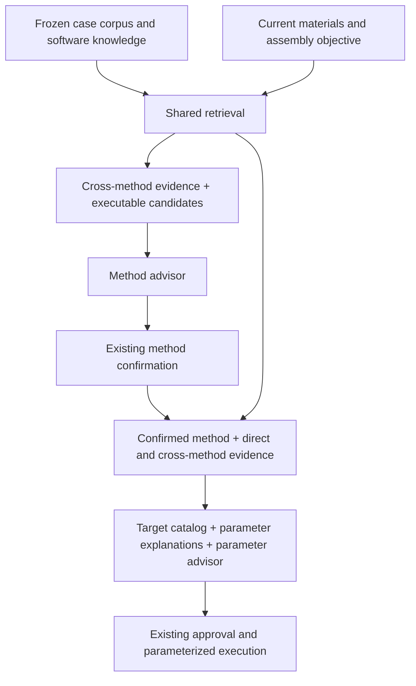

# Assembly Case Consumption and Recommendation

> **Status:** implemented Assembly consumer; biological outcome validation remains separate.
> **Scope:** Assembly method choice and parameter recommendation. Hi-C and T2T
> consumers are deferred.
> **Owns:** case exchange, material queries, retrieval, software explanations and
> the shared literature basis for the two Assembly decisions.
> **Related contracts:** [recommendation policy](recommendation-policy.md),
> [parameter recommendation](parameter-recommendation.md),
> [resource handoff](resource-handoff.md), and [conformance](conformance.md).

## Recommendation objective

Recommend a useful first assembly method and configuration for the current
sample, available data and intended output. The advisor combines reported case
experience, software mechanisms and its own domain knowledge. A matched case or
a controlled method comparison is not a prerequisite for making a recommendation.
Matched comparisons strengthen a preference when present. Suggested preferences
are not measured performance rankings or calibrated probabilities of success.

The consumer is rebuilt around one case source and one retrieval service. The
cutover replaces the old Assembly literature consumers; it does not add V1/V3/
pilot auto-detection, compatibility adapters, or a fallback to old case cards.
Existing execution, approval and immutable parameter-attempt infrastructure keep
their established owners.

## Case exchange and producer boundary

The producer retains `assembly-extraction.v5` as its execution-fact graph and
supplies graphs for self-contained `recommendation-cases.v1` paper packages.
`scripts/build_assembly_cases.py` projects explicitly selected Assembly steps;
the older producer pilot exchange is not accepted by the runtime.
One paper contains zero or more cases. A case represents an identified sample or
explicit sample group using a particular method configuration for a particular
assembly task. Shared configurations remain identifiable across sample cases.

Each case exposes the following information:

| Information | Required semantics |
|---|---|
| Paper and case identity | Stable paper/case identity and available title/DOI/source locations |
| Task and material | Assembly operation, sample background, direct inputs and their processing state, output intent |
| Source method | Explicit software name, reported version and mode when known; primary/supporting tool roles stay distinguishable |
| Source settings | Reported names, values or exact setting text in the source software's vocabulary, including CLI flags and configuration keys |
| Matching observations | Sample and input measurements, units, reported/derived origin, object/platform/state binding and missing information |
| Results and use | Execution status, route role, outcomes with their evaluated object and whole-workflow attribution |
| Qualifications | Source gaps, unresolved settings and extraction/review scope |

A software case eligible to inform assembler choice identifies its assembler;
unknown/manual operations can remain supporting context. Unknown version or
mode stays unknown. Case software names are source identities, not executable
Gene Agent method IDs. `hifiasm` plus its input mode can map to different executable
methods. Consumer indexes derive tool keys from the authoritative method record
rather than maintaining a second independently editable identity.

The producer does not filter settings against the target consumer method's L2
catalog. In particular, a NextDenovo setting remains available when the target is
hifiasm. Unrecognized settings remain readable source text. Lack of a recognized
adjustable setting is not a reason to discard an otherwise informative case.
Missing settings do not become defaults. Source software settings such as genome
size remain configuration observations, not independent sample measurements.

The consumer reads the case contract without importing the producer repository
or reconstructing the full v5 graph. The explicit offline projection builds
the new exchange from existing graphs. It does not merely relabel pilot/legacy
JSON or remove method/settings content to satisfy the consumer.

## Current material query

One Assembly material query is built before method recommendation and reused for
parameter recommendation. It includes the target output, sample/genome facts,
available input platforms and resource-bound read measurements. Resource limits
remain executor-owned, not case-matching features. Missing observations stay missing.

Read measurements identify their actual input resource, platform and processing
state. A single QC aggregate is not assigned to every available platform.
Derived coverage retains its read-total and genome-size basis. Raw and filtered
reads, mean length and N50, assembly N50 and read N50, k-mer estimates and final
assembly measurements remain distinct. Knowing the case's method does not resolve
the identity of the current run's measured reads.

The method decision uses available resources; after confirmation the parameter
decision also receives the selected route and read type. File bindings remain
in executor records. This is an additional view of the same observed materials,
not a newly invented profile.

## Retrieval

Retrieval chooses useful evidence; the advisor chooses a method/configuration.
Neither a foreign tool nor a different input platform is a blanket exclusion
from reference material. Executable candidate compatibility is enforced separately.
Differences in platform, processing state, output target and software mode are
shown to the model alongside similarities.

Use deterministic structured matching plus lexical retrieval over compact case
text for the first implementation. Both are over one corpus. Structured matching
compares only commensurable known observations; lexical retrieval covers sample
background, assembly difficulty, actions and mechanism vocabulary that cannot be
reduced to numeric distance. Union the candidate lists and fuse their ranks;
preserve the component matches and missing-feature coverage for interpretation.
Do not turn feature completeness or a ranking score into biological confidence.
An embedding service or an additional model reranker is not required initially.

The initial implementation uses token overlap normalized by token counts (not
BM25), structured relative-distance scores, and weighted reciprocal-rank fusion
(material 2, lexical 1; damping 10). Comparable observations must match name,
unit, platform and processing state. The parameter purpose adds a small same-tool
bonus (0.002); repeated tools receive a modest diversity penalty (0.15).
Defaults are five whole cases, two per independent source, and 32,000 compact
JSON characters including settings and explanations. Shared configurations are
deduplicated within a paper. These are uncalibrated retrieval heuristics.

The service has two purpose-specific selections over the same frozen corpus:

| Purpose | Evidence selection |
|---|---|
| Method choice | Broad material/task matches across assemblers, with relevant software/mode diversity; no preselected-method filter |
| Parameter recommendation | Material/task matches across assemblers plus targeted matches for the confirmed method and useful configuration/mechanism examples |

Same-method examples provide direct context; foreign-method examples can explain
how a comparable assembly problem was handled. Method identity affects relevance
and presentation, not admission to the reference corpus. Same-method examples
with little material similarity cannot automatically displace a strong foreign
example. Missing parameters do not remove method-use or failure experience.

Performed alternatives and benchmark branches can be informative; retain their
roles. Described-only actions cannot stand in for performed results. Failed or
unselected outcomes are context for judgement rather than automatically discarded
negative examples.

Budget the complete case together with its settings, qualifications and necessary
software explanations. Deduplicate shared configurations and reused data, cap
concentration by paper, and consider method diversity among relevant candidates.
Do not require equal software quotas or fill the budget with unsupported matches.
Allow no literature matches while still supplying the current facts and software
knowledge to the advisor.

## Software and parameter explanations

The consumer owns reusable software knowledge separate from individual paper
cases. It covers task/input/output capabilities, algorithm/mode context and the
meaning of settings. The source case owns what the paper did; the software
explanation owns what that software setting controls.

For a retrieved setting, an explanation identifies its source tool and version
scope, native flag/config key, value semantics/unit, algorithmic effect and
relevant interactions. Reuse executable catalog metadata where it actually
explains those things. Maintain additional referenced mechanism guidance where
needed, including settings not exposed by the current execution adapter.
CLI flags and configuration keys both require support. Unknown semantics remain
unknown rather than receiving a fabricated equivalence.

Attach compact method descriptions at method choice. At parameter recommendation,
include explanations for relevant retrieved settings and the target method's
adjustable catalog/guidance. Deduplicate shared explanations within the prompt;
do not append every tool's complete manual or parameter catalog to every case.

Cross-method reasoning can transfer a problem interpretation or tuning strategy
and can propose a target-tool value when its semantics and current data support
that choice. It must not implement a mechanical parameter-name/value translation
table. For example, a read-retention cutoff can inform reasoning about retained
coverage; an internal graph control is interpreted in its own algorithm before
considering any target-tool setting. Source L0/L1 values may explain historical
context but never overwrite current executor bindings or sample facts.

## Decision sequence

Both advisors use the same frozen corpus, material facts and software knowledge;
their evidence projections can differ. Parameter retrieval may add targeted
cases from that same snapshot after method confirmation. The parameter request
also retains the method decision's reasons and relevant case context. This uses
the existing two decision boundaries, not a third LLM retrieval/translation call.

When method choice is open, a highly relevant NextDenovo case is available before
the advisor proposes the assembler. The advisor can recommend NextDenovo if its
capabilities, current input data, output objective and case/mechanism context
support doing so. A case need not establish NextDenovo's superiority in a paired
experiment. Relevance alone also does not mechanically select its software.

When the task is explicitly scoped to tuning hifiasm, or hifiasm has been confirmed,
NextDenovo remains reference evidence. The parameter advisor emits only the
target method's sparse L2 mapping. It cannot silently replace the confirmed method.
Changing that decision is an explicit method-selection transaction, not parameter
retry. This contract does not add an automatic method-switch loop or a new
RunConfig method field.

The executable candidate set comes from implemented methods, supported input/mode
bindings and resolvable execution requirements. A useful reference method need not
be locally executable. The model must distinguish reference tools from available
execution choices. Candidate capability summaries accompany their IDs.

## Frozen inputs, model projection and ownership

The single new source is optional: no source means empty literature evidence plus
software knowledge, not reactivation of an old case library. The consumer captures
the selected corpus and software knowledge into its own immutable run artifacts
at input preparation, retaining their identity for both decisions and resume.
It does not require an approval marker or run record to be written into producer
cases. Preliminary extraction/review scope remains explicit evidence context.

Configure `assembly.case_source` as a directory of exchange JSON files; paths are
resolved relative to the run config. Preparation reads the corpus and catalogs
once; freezing publishes `control/assembly_knowledge.json` (schema 5) together
with the existing control files, under the same final commit marker and hashes.
Old Assembly markers lacking this snapshot are rejected. The exchange loader
rejects old schemas, duplicate identities, non-regular/symlink case files and
oversized payloads (8 MiB per paper, 64 MiB total).

Method and parameter model requests contain bounded readable evidence and the
reason for relevance. Storage paths, full retrieval traces and snapshot hashes
remain in durable records rather than becoming instructions for the model.
The existing parameter basis freezes the exact parameter selection and software
explanations; retries inherit it and add their existing ordered attempt history.
Resume and retries use captured contents rather than reopening a mutable producer
directory. Case loading errors and an honest empty match remain distinguishable.

| Owner | Responsibility |
|---|---|
| `app/knowledge/` | One case contract, loading/snapshot, indexing, retrieval and bounded evidence projection |
| `app/domains/assembly/` | Current-material query, method identity/capability mapping and software semantics |
| `app/stages/assembly/` | Retrieve before method choice, bind confirmation, persist each decision and reuse its evidence |
| `app/llm/` | Separate method/parameter requests and prompts; cross-method interpretation with target-only executable outputs |
| Existing storage/review/execution modules | Immutable record identity, approval, retry lineage and command resolution |

## Cutover and acceptance

The rebuilt Assembly path replaces the V1 case API, V3 facts consumer, old
hifiasm numeric/card projection and their Assembly runtime selection branches.
Audit other callers before deleting shared pack utilities used outside Assembly.
Retain useful execution catalogs and move reusable method guidance under its new
owner. Do not import old cases automatically or keep legacy readers as fallback.
Source papers and unrelated user data are not cleanup targets.

Existing persisted runs are not converted or silently resumed through new
semantics. Affected pre-cutover checkpoints fail explicitly at the compatibility
boundary; preserving old record files does not require retaining multiple live
recommendation implementations. Shared attempt-record schemas need not change
solely because their literature payload changes.

Acceptance must cover:

- A complete new paper case, including method and native settings, survives the
  real loader, query, retrieval, request, renderer and immutable basis path.
- A materially close foreign-method case reaches both open method choice and
  target-method parameter reasoning; a weak same-method case does not always win.
- A NextDenovo configuration key is retained with its software meaning even when
  absent from the hifiasm L2 catalog; target execution still rejects foreign keys.
- Missing/uneven case coverage allows advice from available material and software
  knowledge, without fabricated cases, observations or numeric success probabilities.
- Mixed input platforms, raw/filtered states, source-setting versus measurement
  provenance, shared configurations and complete-card budgets remain distinct.
- Frozen evidence survives source-directory modification/removal; parameter retry
  preserves the confirmed method and initial basis; baseline and approval paths
  retain their existing contracts.
- The production Assembly path has one consumer implementation and no old-source
  fallback. Hi-C and T2T behavior is unchanged by this scoped rebuild.

The request, projection, frozen-input and cross-method regressions are in
`tests/test_assembly_case_consumption.py`, with existing approval/retry tests
covering unchanged transaction boundaries. They are not assembly-quality
experiments. Software explanations currently cover catalog flags/config keys
and existing hifiasm mechanism guidance, not every historical tool setting.
Projection validates selected bindings, not the complete producer graph or
its original-paper support. Current gaps are recorded in
[conformance](conformance.md#assembly-software-explanation-coverage).
